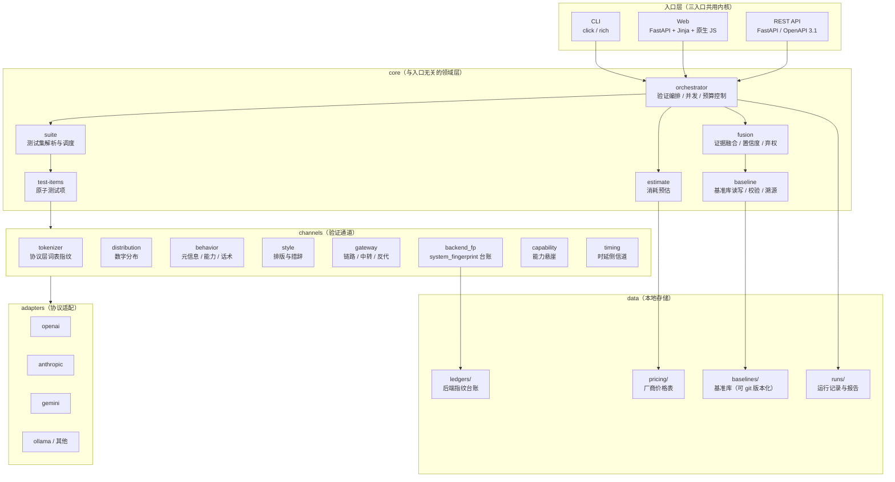
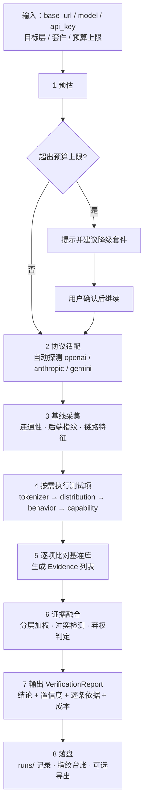

# ModelProof 开源项目规划

> 版本 v0.1-draft · 2026-10-17
> 定位：**用可验真数据鉴别与验证大模型身份**的开源工具链与基准库。

---

## 0. 一句话定位与设计信条

**ModelProof** 通过一组可复现的主动探测，采集待测模型的**协议层指纹、输出分布、行为特征与链路特征**，与社区维护的**基准模型数据（对照组）**逐项比对，分层给出「这是什么模型、是不是它声称的那个、把握有多大」，并输出**可逐条复核的证据链**。

五条设计信条，贯穿全部设计决策：

| # | 信条 | 具体含义 |
|---|---|---|
| 1 | **可验真优于可判定** | 结论必须能追溯到原始观测值。宁可给不出结论，也不给没有依据的结论。 |
| 2 | **分层判定，分开报** | 厂商 / 家族 / 系列 / 版本 四层各自独立给置信度，不混成一个分数。 |
| 3 | **会弃权** | 闭集归因一定会把未收录模型硬塞给最相似候选。必须显式建模「我不知道」。 |
| 4 | **数据必须带溯源** | 基准库里每一条数据都要写明「谁、何时、用什么方式、在什么端点采的」。没有溯源的基准数据不可信。 |
| 5 | **防御性、无害** | 全部探针无害；只用于探测用户自己有权探测的端点；不把结果当法律或纪律证据。 |

---

## 1. 项目定位与边界

### 1.1 解决什么问题

三类真实痛点，对应三类用户：

| 痛点 | 场景 | 用户 |
|---|---|---|
| **真伪** | 买来的「Claude Opus」API，实际是不是 Haiku 或贴牌 Qwen？ | 开发者、采购方 |
| **身份** | 一个没有标注的 `/v1/chat/completions` 端点，背后到底是什么模型和版本？ | 平台运维、网关管理员 |
| **变更** | 上游静默换版本 / 换部署，我的回归测试结果突然对不上，怎么第一时间发现？ | 质量工程、SRE |

### 1.2 与 ModelTrace 的关系

ModelProof 借鉴 ModelTrace 的核心思路，并在四个方向上做实质性扩展：

| 维度 | ModelTrace（现状） | ModelProof |
|---|---|---|
| 信号 | 主要靠数字分布一条 | 八条通道，证据融合 |
| 结论 | 单一排序 + 概率 | 四层独立判定 + 冲突检测 + 弃权 |
| 基准 | 仓库内置，采集者自维护 | 独立版本化基准库 + 溯源分级 + 社区贡献流程 |
| 入口 | 仅 Web | CLI / Web / REST API 三入口共用内核 |
| 预算 | 无 | 测试前给出 token / 耗时 / 费用区间，可设上限 |
| 真伪 | 不涉及 | **一等公民**：声明身份 vs 实测身份的对照验证 |

一句话概括：**ModelTrace 是「一张强指纹做闭集归因」的工具，ModelProof 是「一套证据链做身份验证」的工具链。**

### 1.3 不做什么（显式边界）

- ❌ 不做**模型能力评测**。ModelProof 不问「这个模型好不好」，只问「这是不是它」。
- ❌ 不做**内容安全/水印检测**。不判断文本是否 AI 生成。
- ❌ 不做**攻击性探测**。不绕过鉴权、不做未授权扫描、不做拒绝服务式测量。
- ❌ 不提供**法律或纪律意义上的证据**。统计指纹必然有误报，结果不得用于对个人或组织的指控、处罚、违约认定。
- ❌ 不托管用户数据。默认全部本地运行，遥测默认关闭。

### 1.4 合规与负责任使用（随仓库发布的 `RESPONSIBLE_USE.md`）

1. **授权前提**：只对你拥有或已获授权测试的端点运行。
2. **探针无害**：新增探针必须通过「无害审查」——不得要求模型输出有害内容，不得试图绕过模型自身的安全对齐。对齐类探针只走「过度承诺」轴（如金融/法律建议），只观察拒绝方式，不索取有害内容。
3. **数据最小化**：默认不落盘原始 prompt 与回答全文，只保存统计指纹与必要的观测值；需要留存时必须显式开启。
4. **不用于指控**：README 与每次 CLI/Web 结果都要显示免责声明。
5. **漏洞披露**：若探测发现第三方服务存在凭据泄露等安全问题，走 `SECURITY.md` 的协调披露流程，不公开细节。

---

## 2. 产品形态：三入口一体

### 2.1 能力矩阵

三个入口**共用同一个 `core` 包**，能力严格一致；差异只在呈现方式与并发/批处理能力。

| 能力 | CLI | Web | REST API |
|---|---|---|---|
| 单次验证 | ✅ | ✅ | ✅ |
| 手动（粘贴）验证 | ✅ `--stdin` | ✅ | ✅ |
| 测试集管理 | ✅ | ✅ | ✅ |
| 基准库 CRUD | ✅ | ✅ | ✅ |
| 基准采集（自采） | ✅ | ✅ | ✅ |
| 消耗预估 | ✅ | ✅ | ✅ |
| 报告导出（JSON / MD / HTML） | ✅ | ✅ | ✅ |
| 批量验证（多端点） | ✅ | ❌（v1.1） | ✅ |
| 定时巡检 / 指纹监控 | ✅ `watch` | ❌（v1.2） | ✅ |
| CI 集成（退出码 / JUnit XML） | ✅ | ❌ | ✅ |

### 2.2 CLI

```bash
# 快速验证一个端点（默认 quick 套件）
modelproof verify https://api.example.com/v1 \
  --model claude-opus-5-5 --api-key $KEY

# 指定目标层 + 套件 + 预算上限
modelproof verify https://api.example.com/v1 --model gpt-6-astra \
  --suite deep --target version --max-cost 0.50 --max-seconds 300

# 验证「它是不是自己声称的那个」（真伪模式）
modelproof verify https://api.example.com/v1 --claim claude-opus-5-5 --suite standard

# 手动模式：不在本地调 API，生成提示词让你自己去问
modelproof suite emit --suite standard --format prompts > prompts.txt
modelproof verify --from-file answers.jsonl --suite standard

# 消耗预估（不实际跑）
modelproof estimate --suite deep --model gpt-6-astra --price-table openai

# 基准库
modelproof baseline list --vendor anthropic
modelproof baseline show claude-opus-5-5
modelproof baseline import https://api.anthropic.com --model claude-opus-5-5 --samples 36
modelproof baseline validate ./baselines/models/claude-opus-5-5.json
modelproof baseline contribute ./baselines/models/qwen3-6-plus.json   # 生成 PR 包

# 报告
modelproof report show <run_id> --format md
modelproof report diff <run_id_a> <run_id_b>       # 两次运行对比（看上游是否变了）

# 持续监控后端指纹
modelproof watch add https://api.example.com/v1 --model deepseek-chat --interval 6h
```

退出码：`0` 判定成功 · `1` 运行失败 · `2` 弃权（无法判定）· `3` 真伪不符（CI 里用于阻断）。

### 2.3 REST API

OpenAPI 3.1，路径与 CLI 子命令一一对应。核心端点：

```
POST   /v1/verifications                 # 发起验证（同步或 async=1）
GET    /v1/verifications/{id}            # 取结果
GET    /v1/verifications/{id}/report     # 报告（json|md|html）
POST   /v1/estimates                     # 消耗预估
GET    /v1/suites                        # 测试集列表
POST   /v1/suites                        # 自定义测试集
GET    /v1/test-items                    # 测试项目录（含成本元数据）
GET    /v1/baselines                     # 基准库检索
GET    /v1/baselines/{model_id}
POST   /v1/baselines                     # 录入
GET    /v1/watchers                      # 巡检任务
GET    /v1/healthz
```

认证：本地默认 `127.0.0.1` 无鉴权；对外暴露时必须配置 bearer token。所有请求体里的 `api_key` 只在内存中流转，不写日志、不落盘。

### 2.4 Web

见第 10 章。

### 2.5 结果互通：`VerificationReport`

三个入口输出**同一个 JSON 结构**（第 6.6 节与附录 A 给出完整 Schema）。CLI 负责把它渲染成表格 / Markdown / HTML，Web 负责可视化，API 直接返回。任何一次运行都可导出为 `report.json`，再被任一入口读入 —— 这是「结果互通」的落地方式。

---

## 3. 整体架构

### 3.1 分层架构



### 3.2 目录结构

```
modelproof/                     # 主仓库（代码）
├── core/
│   ├── orchestrator.py         # 验证编排：调度、并发、预算中断、重试
│   ├── report.py               # VerificationReport 结构与序列化
│   ├── estimate.py             # 消耗预估
│   ├── fusion/
│   │   ├── evidence.py         # 证据模型
│   │   ├── calibrate.py        # 留一法标定与阈值管理
│   │   └── decide.py           # 分层判定 / 冲突检测 / 弃权
│   ├── baseline/
│   │   ├── schema.py           # BaselineEntry 定义与校验
│   │   ├── store.py            # 读写、索引、版本迁移
│   │   ├── provenance.py       # 溯源与可信度分级
│   │   └── contribute.py       # 贡献包生成与校验
│   ├── suite/
│   │   ├── registry.py         # 测试项注册表
│   │   └── model.py            # Suite / TestItem 定义
│   └── channels/
│       ├── tokenizer.py
│       ├── distribution.py
│       ├── behavior.py
│       ├── style.py
│       ├── gateway.py
│       ├── backend_fp.py
│       ├── capability.py
│       └── timing.py
├── adapters/                   # 协议适配（统一 Completion 接口）
├── cli/
├── web/
│   ├── main.py                 # FastAPI 路由
│   ├── templates/
│   └── static/
├── suites/                     # 内置测试集 YAML
├── pricing/                    # 厂商价格表 YAML
├── tests/
└── docs/

modelproof-baselines/           # 独立仓库（数据，可 git 版本化、可 PR）
├── vendors/
├── families/
├── models/                     # 每个模型一个 JSON
├── fingerprints/
│   ├── tokenizer/
│   ├── style/
│   └── gateway/
└── SCHEMA.md
```

### 3.3 关键抽象

四个接口决定了整个系统的可扩展性：

```python
class Channel(Protocol):
    id: str                                   # "tokenizer"
    yields: set[TargetLayer]                  # {VENDOR, FAMILY} — 这条通道能证明到哪一层
    reliability: float                        # 由 calibrate.py 标定，非人工拍脑袋
    def collect(ctx: RunContext) -> list[Evidence]
    def estimate(model: str) -> Cost

class Comparator(Protocol):
    """把一个观测值与基准数据比成一条证据。每种数据类型一个实现。"""
    def compare(observed, baseline) -> Evidence

class Adapter(Protocol):
    """抹平 OpenAI / Anthropic / Gemini / Ollama 的差异。"""
    def complete(prompt, **opts) -> Completion     # 含 usage、system_fingerprint、原始 headers
    def count_tokens(text) -> int
    def list_models() -> list[str]

class Store(Protocol):
    """基准库后端。默认文件系统，可替换为 SQLite / 远端索引。"""
    def get(model_id) -> BaselineEntry
    def search(**filters) -> list[BaselineEntry]
```

---

## 4. 核心验证流程

### 4.1 流程图



### 4.2 六个阶段说明

**1. 预估（estimate）** —— 见第 8 章。这一步**不发任何请求**，纯查表计算。

**2. 协议适配（adapt）** —— 用最小请求（单 token 输出）依次试探 OpenAI / Anthropic / Gemini，命中即锁定。锁定后所有测试项复用同一适配器，避免每个探针都重试三种协议。

**3. 基线采集（baseline facts）** —— 这阶段几乎是免费的，且**不需要任何先验**就能出结果：
- 连通性与协议
- `system_fingerprint` / `modelVersion` + 台账比对
- TLS 证书签发者、ALPN、JA3S
- 响应头特征（`openai-processing-ms`、`x-amzn-requestid`、`apim-request-id`、`via`、`server`）
- `/v1/models` 形态
- 端点面（`embeddings` / `moderations` / `responses` / `count_tokens`）

**4. 按需执行测试项** —— 按套件声明的顺序跑。支持并发（默认 4），但同一端点串行以保证时序测量有效。

**5. 逐项比对** —— 每种数据类型一个 `Comparator`，产出 `Evidence`。基准库里缺对应数据时产出 `Evidence(match=None)`，记为「无对照」，不计入得分（不能因为没数据就当成不匹配）。

**6. 证据融合与判定** —— 第 6 章。

### 4.3 四层判定

判定难度递增，每层独立输出结论与置信度。高层判定失败不影响低层结论。

| 层级 | 举例 | 主要依靠 | 目标准确率 |
|---|---|---|---|
| **L1 厂商 vendor** | Anthropic / OpenAI / Google / 阿里 | tokenizer、响应头、证书、自述 | ≥ 98% |
| **L2 家族 family** | claude / gpt / gemini / qwen / kimi | tokenizer、数字分布 | ≥ 95% |
| **L3 系列 series** | opus / sonnet / haiku；gpt-6 / gpt-5.6 | 数字分布、行为、能力悬崖 | ≥ 85% |
| **L4 版本 version** | opus-5.5、gpt-6-astra、qwen3.5-397b-a17b | 元信息（截止日期/上下文）、后端指纹、数字分布 | ≥ 70% |
| **P 真伪 truthfulness** | 它是不是自己声称的那个 | 上述四层 + 声明值逐项核对 | 二值 + 置信度 |

**真伪模式（P）** 是 ModelProof 相对 ModelTrace 新增的核心能力：用户显式给出 `--claim claude-opus-5-5`，程序逐项核对声明值（`knowledge_cutoff`、`context_window`、`system_fingerprint`、分布中心、行为向量），输出一张「声明 vs 实测」对照表，并给出 `consistent / suspicious / contradicting`。

---

## 5. 验证通道与测试项设计

### 5.1 通道总览

| # | 通道 | 观测什么 | 抗干扰 | 能证明到 | 单次成本量级 |
|---|---|---|---|---|---|
| C1 | **tokenizer** | 固定文本被数成多少 token | 最高（词表训练时固定） | L1/L2 | 37 请求，输入 ~2.2k |
| C2 | **distribution** | 随机长整数的分布与有序块 | 中（受系统提示词影响） | L2/L3/L4 | 3 请求，输出 ~2.7k |
| C3 | **behavior** | 自述、知识截止、上下文、话术、代码风格 | 低（自述可伪造） | L3/L4 | 12 请求，输出 ~1k |
| C4 | **style** | 排版密度、Markdown 习惯、措辞习惯 | 低 | L2/L3（辅助） | 0–1 请求 |
| C5 | **gateway** | TLS / 响应头 / 模型列表 / 错误体 / 流式 | —（不问身份，问入口） | 链路性质 | 8 请求 |
| C6 | **backend_fp** | `system_fingerprint` 有无与变化 | 高 | L4 + 变更检测 | 0（搭车采集） |
| C7 | **capability** | 能力悬崖（汉诺塔、字母计数、长上下文召回） | 中 | L3/L4 | 6 请求 |
| C8 | **timing** | TTFT、TPS、首 chunk 间隔 | 低（受负载影响大） | 辅助一致性 | 0（搭车采集） |

**设计要点**：C1 与 C6 是「硬信号」（改不了），C3/C4/C8 是「软信号」（能伪造）。融合时硬信号权重远高于软信号，且**软信号只能降低置信度，不能单独支撑结论**。

### 5.2 各通道要点

**C1 tokenizer** —— 边际 token 成本向量。
```
边际成本 = usage.prompt_tokens(探针串) − usage.prompt_tokens(单 token 基线)
```
37 条探针覆盖英文全字母句、连续数字、中日韩（含韩文组合字母）、阿拉伯、希伯来、泰文、西里尔、天城文、希腊、肤色/ZWJ/国旗/职业 emoji、组合附加符、星平面字符、各类空白、缩进、代码、JSON、Base64、URL、驼峰/下划线标识符、多文种混排。
判定：相对差 ≤0.5% 且 ≥95% 格子相同 → 同一词表；≤0.5% → 高度接近；≤6% → 同家族附近。
实测区分度：不同家族 18%–31%，同一词表 0%。**同家族不同版本共用词表，所以 C1 到 L2 为止。**

**C2 distribution** —— 借鉴 ModelTrace：3–10 条不重复的长整数生成挑战（长度取自 292–332），Hellinger 距离 + 有序块特征，闭集 softmax + 校准温度。**这是唯一在词表相同时还能分开近亲版本的传统手段。**

**C3 behavior** —— 12 条无害探针：自述身份、知识截止、上下文窗口、strawberry 字母计数、浮点严谨性、代码风格、结构化自述、汉诺塔、对齐话术（金融过度承诺轴）、格式习惯、开场白、多语习惯。
最有价值的用法是**一致性判定**：与已保存的行为参考逐项比对，不依赖任何家族先验。

**C4 style** —— 21 个特征（行长度、CJK/ASCII 比例、标题层级、粗体密度、代码围栏语言标记、列表符号、表格、emoji、hedge 词密度、第一人称密度、首词、结尾套话）。**只在「同一条 prompt 的两个回答」之间有意义。**

**C5 gateway** —— 判定「这个入口是谁搭的」，与模型身份正交。**模型可以是真的 Claude，但入口可能是别人的壳。**
两轴分离：链路轴（中间有几层，不等于有问题）+ 行为轴（在改你的流量）。恶意结论需 ≥2 个独立行为信号。
五档结论：官方直连 / 官方云网关 / 订阅反代 / 第三方中转 / 无法判定。

**C6 backend_fp** —— `system_fingerprint`。OpenAI 定义是「模型运行所依赖的后端配置」。
各家支持：OpenAI / Azure / DeepSeek / Qwen / Moonshot / 智谱 有；**Anthropic 没有**（用带日期模型名）；**Gemini 没有**（用 `modelVersion`）。
DeepSeek 格式自带信息：`fp_<hash>_prod<批次>_<量化>_kvcache`，可直接读出部署批次与 FP8 量化。
**台账机制**：每次验证自动记录（端点, 模型, 指纹），指纹一变即告警——2026-10-17 DeepSeek 上线 V4.1-Flash-1017 时，网友正是靠 `aeb56401…` → `e72d3c7f…` 提前发现的。

**C7 capability** —— 能力悬崖：汉诺塔 5 盘（31）、strawberry 字母计数（3）、长上下文召回（在 100k 上下文里埋针）、多跳算术、指令跟随（严格 JSON）。用于分离系列（Opus vs Haiku）。

**C8 timing** —— 搭车采集 TTFT、首 chunk 间隔、稳定期 TPS。**只用于一致性判断（两次运行是否同一后端），绝不用于身份判定。**

### 5.3 测试项元数据规范

每个测试项是一个原子单元，自带成本声明——这是「消耗预估」与「自由组合」能落地的前提。

```yaml
# suites/items/tokenizer.marginal_cost.yaml
id: tokenizer.marginal_cost
channel: tokenizer
name: 协议层词表指纹
yields: [vendor, family]          # 能证明到哪一层
requires: [usage]                 # 前置能力：响应必须带 usage
cost:
  requests: 37
  input_tokens: 2200              # 期望值；预估时用 min/expected/max
  input_tokens_range: [1800, 2600]
  output_tokens: 37
  seconds: 12
  seconds_range: [8, 25]
  price_note: 输入主导，输出仅 1 token/请求
side_effects: [writes_ledger]
manual_supported: false           # 手动模式能不能做（需要读 usage，粘贴做不到）
params:
  probe_set: core|full            # 可选：核心 18 条 / 全部 37 条
```

### 5.4 内置测试集

| 套件 | 目标层 | 测试项 | 期望耗时 | 期望费用（gpt-6-luna） | 期望费用（gpt-6-astra） |
|---|---|---|---|---|---|
| `quick` | L2 家族 | C1 核心 + C3 元信息 3 条 + C6 + C5 轻量 | ~25 s | ~¥0.002 | ~¥0.22 |
| `standard` | L3 系列 | `quick` + C2（3 份）+ C3 全 12 条 + C7 | ~3 min | ~¥0.016 | ~¥1.6 |
| `deep` | L4 版本 | `standard` + C2（10 份）+ C1 全部 + C4 + C5 完整 | ~12 min | ~¥0.06 | ~¥6 |
| `truth` | P 真伪 | 按声明值动态挑选最有判别力的项 | ~4 min | ~¥0.02 | ~¥2 |
| `link-only` | — | 仅 C5（不消耗生成额度） | ~10 s | ~¥0 | ~¥0 |
| `custom` | 任意 | 用户勾选组合 | 实时计算 | 实时计算 | 实时计算 |

自定义套件可保存在 `suites/custom/*.yaml`，三个入口共用。

---

## 6. 证据融合与置信度

### 6.1 证据模型

一次验证产出一组 `Evidence`：

```jsonc
{
  "channel": "tokenizer",
  "item": "tokenizer.marginal_cost",
  "target_layer": "family",
  "observed_summary": "37 格，与 qwen2.5-3 参考 34 格相同",
  "metric": { "name": "relative_diff", "value": 0.031, "threshold": 0.005 },
  "candidates": [                       // 与基准库里每个候选的比对结果
    { "model_id": "qwen3-5-397b-a17b", "score": 0.969 },
    { "model_id": "claude-opus-5-5",   "score": 0.412 }
  ],
  "match": true,                        // 是否命中（无对照时为 null）
  "weight": 1.0,                        // = channel.reliability × item 权重
  "note": "同一词表无法区分版本，本条只到 family"
}
```

### 6.2 可靠性权重（标定得出，不是拍脑袋）

对每条通道，在基准库上做**留一法**：把某个模型的基准移出候选集，拿它自己的观测去打分，看这条通道把真值排第几、得分分布如何。由此得出 `reliability` 与判定阈值。

方法与 ModelTrace 标定「库外阈值」时一致。示例（v0.1 目标值，需实测更新）：

| 通道 | 留一法 top-1 | reliability | 备注 |
|---|---|---|---|
| tokenizer | ~0.97（家族层） | 1.00 | 硬信号 |
| distribution | ~0.90（家族层）/ ~0.62（版本层） | 0.85 | 受系统提示词影响 |
| backend_fp | —（用于变更检测） | 0.80 | 缺基准时不可用 |
| capability | ~0.70（系列层） | 0.55 | 弱模型也能答对简单题 |
| behavior | ~0.65 | 0.40 | 自述可伪造 |
| style | ~0.60 | 0.25 | 强依赖 prompt |
| timing | — | 0.15 | 只用于一致性 |

所有权重随基准库增长**自动重算**（`modelproof baseline recalibrate`），不允许手改。

### 6.3 分层融合

对每一层独立做一次加权融合：

```text
raw_score(model, layer) = Σ_e weight(e) · score(e, model) / Σ_e weight(e)
P(model | layer)        = softmax(β_layer · raw_score)     // 仅在该层候选集内归一化
```

`β_layer` 同样由留一法标定，每层一个值。层级越高，候选越多、可分性越差，β 越小（概率越平缓）。

### 6.4 冲突检测

不同通道给出的 top-1 不一致时，**不能简单加权平均了事**。规则：

- C1（tokenizer）说 family = qwen，C3（自述）说 family = claude → 记 `conflict`，family 层置信度乘 0.6，并在报告中并列展示两种可能及其证据。
- C1 与 C2 冲突 → 严重冲突，置信度乘 0.4，并提示「极可能是中转做了模型替换」。
- 软信号之间冲突 → 忽略（软信号本来就不稳定）。

冲突检测的价值：它往往是**最有价值的发现**（模型替换、套壳），而不是需要消除的噪声。

### 6.5 弃权规则

满足任一条件即在该层弃权，输出 `abstained: true` 与原因：

1. 该层最高分低于弃权阈值（留一法标定，对应「库内误报率 ≤1%」）。
2. 该层有效候选 < 4 个。
3. 有效证据少于 2 条。
4. 存在严重冲突（6.4）。
5. 半数以上通道因缺少基准数据而「无对照」。

### 6.6 判定依据输出

报告中每一层都给出可读的依据，而不是一个孤立数字：

```
家族层：qwen   置信度 0.93   依据 4 条
  ✅ tokenizer      与 qwen2.5-3 参考 34/37 格相同，相对差 3.1%         (权重 1.00)
  ✅ distribution   与 qwen3-5 中心相似度 0.81，第二名 deepseek-v4 0.52  (权重 0.85)
  ✅ behavior       自述「通义千问 Qwen3.5，阿里云」                     (权重 0.40)
  ⚠️ gateway        非官方域名 + nginx Server 头，但行为类无异常          (链路，不计分)

版本层：弃权   原因：最高分 0.61 < 阈值 0.72；qwen3.5 与 qwen3.6 词表相同、
      数字分布接近，需补 knowledge_cutoff 与 context_window 才能定
```

---

## 7. 基准数据管理

### 7.1 BaselineEntry 数据模型

```jsonc
{
  "schema_version": "1.0",
  "model_id": "claude-opus-5-5",
  "aliases": ["claude-opus-5.5", "opus-5.5"],

  "identity": {
    "vendor": "anthropic",
    "family": "claude",
    "series": "opus",
    "version": "5.5",
    "release_date": "2026-08",          // 置信度标记在字段级
    "knowledge_cutoff": "2026-04",      // { value, confidence }
    "context_window": 1000000,
    "max_output_tokens": 128000,
    "modalities": ["text", "image", "pdf"]
  },

  "channels": {
    "tokenizer": {
      "probe_version": "tk1-37",
      "overhead": 8,
      "counts": { "en_pangram": 9, "zh_tech": 21, "...": 0 }
    },
    "distribution": {
      "samples": 36,
      "center": [0.021, 0.019, "..."],   // 归一化的数字分布中心
      "ordered_block": { "...": 0 },
      "temperature": "default"
    },
    "behavior": {
      "probe_version": "bh1-12",
      "vector": { "identity": "claude", "cutoff": "2026-04", "context": 1000000 }
    },
    "style": { "features": { "...": 0 } },
    "backend_fp": { "known_values": ["fp_..."], "note": "官方轮换多个值" },
    "gateway": {
      "official_hosts": ["api.anthropic.com"],
      "ja3s": ["771,4866,51-43"],
      "cert_issuer": "Cloudflare / Amazon"
    }
  },

  "pricing": { "input_per_mtok": 5.0, "output_per_mtok": 25.0, "currency": "USD", "as_of": "2026-10" },

  "provenance": {
    "tier": "official",                  // official | community | derived
    "collected_by": "github:@alice",
    "collected_at": "2026-10-01T09:12:00Z",
    "endpoint": { "base_url": "https://api.anthropic.com", "tls_verified": true, "ja3s_matched": true },
    "method": "modelproof baseline import v0.4.1",
    "sample_count": 36,
    "reviewers": ["github:@bob"],
    "notes": "官方端点自采，TLS 与 JA3S 已核对"
  },

  "quality": {
    "completeness": 0.86,                // 各通道数据是否齐全
    "freshness_days": 16,
    "auto_checks": { "probe_version_match": true, "sample_count_ok": true, "internal_consistency": true }
  }
}
```

### 7.2 目录结构

```
modelproof-baselines/
├── SCHEMA.md
├── vendors/anthropic.yaml          # 厂商元信息、官方域名、JA3S 参考
├── families/claude.yaml            # 家族级公共特征（词表、风格倾向）
├── models/
│   ├── anthropic.claude-opus-5-5.json
│   ├── openai.gpt-6-astra.json
│   └── ...
├── fingerprints/
│   ├── tokenizer/                  # 可跨模型共享的词表参考（一个词表一份）
│   ├── style/
│   └── gateway/
└── CHANGELOG.md
```

**共享指纹**：同词表的多个模型共用一份 `fingerprints/tokenizer/<vocab>.json`，避免重复存储，也让「同词表 ⇒ 到 L2 为止」这个约束在数据层面显式化。

### 7.3 溯源与可信度分级

这是 ModelProof 相对同类工具的关键差异化。没有溯源的基准数据不可信。

| 级别 | 含义 | 准入要求 | 融合权重系数 |
|---|---|---|---|
| `official` | 在厂商官方端点自采 | TLS 已校验 + 官方域名 + JA3S 匹配 + 采样数达标 | 1.0 |
| `community` | 社区在第三方端点采集 | ≥2 名 reviewer 复核 + 内部一致性自检通过 | 0.8 |
| `derived` | 从公开资料推导（如词表大小、上下文窗口） | 必须标注来源 URL 与日期 | 0.5（且只用于软提示） |

`derived` 级数据**不得单独支撑任何结论**，只能作为佐证。

### 7.4 录入 / 采集 / 校验 / 贡献流程

```bash
# 1) 自采（推荐）：从官方端点自动采集全部通道数据
modelproof baseline import https://api.anthropic.com \
  --model claude-opus-5-5 --samples 36 --tier official

# 2) 手工录入（用于无法直连的端点）
modelproof baseline edit anthropic.claude-opus-5-5        # 打开结构化编辑器

# 3) 本地校验（CI 也会跑）
modelproof baseline validate models/*.json
# 检查项：schema 合法 · probe_version 与当前内核一致 · 采样数达标 ·
#         内部一致性（identity 与 behavior 自述不矛盾）· 溯源字段完整

# 4) 生成贡献包（自动补 provenance、跑校验、生成 PR 描述）
modelproof baseline contribute models/openai.gpt-6-astra.json
```

CI 门禁：任何 PR 必须 `validate` 全绿；`official` 级数据必须由具有相应权限的维护者复核 TLS/JA3S 证据。

### 7.5 版本化与迁移

- 基准库独立仓库，语义化版本（`baselines-v1.4.0`），主程序声明兼容范围。
- `schema_version` 变更时提供 `migrations/` 脚本，`modelproof baseline migrate` 自动执行。
- **探针版本强约束**：`probe_version` 与内核不一致的数据**直接拒绝加载**（宁可缺数据，也不能拿不可比的数据算分）。
- 每月发布一次快照 release，供无法联网的环境 vendored 使用。

---

## 8. 消耗预估

### 8.1 成本模型

```text
单次验证总成本 = Σ_test_items ( 请求数 · 单请求延迟
                              + 输入 token · 输入单价
                              + 输出 token · 输出单价 )
```

三类资源分开估算，因为瓶颈不同：

| 资源 | 决定因素 | 不确定性来源 |
|---|---|---|
| **请求数** | 完全确定（测试项声明） | 无 |
| **token** | 输入完全确定；输出是期望值 | 模型实际输出长度、是否思考型模型（reasoning tokens） |
| **耗时** | 请求数 × 单请求延迟 | 网络、排队、负载、思考预算 |

### 8.2 输出 token 的处理

输出是主要不确定性来源。两种模型：

- **固定输出**：tokenizer 探针用 `max_tokens=1`，完全确定。
- **自由输出**：数字分布（一次性吐数百个数字）、行为探针（长短不一）。

策略：测试项声明 `output_tokens_range: [min, expected, max]`，预估时给**区间**；同时用该模型历史运行的中位数做校准（存在 `runs/` 里）。

**思考型模型额外提示**：若目标模型支持 `reasoning_effort`，预估时按 `reasoning_tokens ≈ output_tokens × 3` 额外计入，并在 UI 上标红提示「思考型模型的实际开销可能是预估的 2–4 倍」。

### 8.3 预估输出示例

```text
$ modelproof estimate --suite standard --model gpt-6-astra --price-table openai

套件 standard · 目标层 series · 12 项测试
─────────────────────────────────────────────────
请求数        56 次
输入 token    ~4,900   (4,100 – 5,700)
输出 token    ~6,200   (3,800 – 12,400)   ← 区间较宽：数字分布项输出长度波动大
预计耗时      2 分 40 秒 (1 分 50 秒 – 4 分 30 秒)
预计费用      $0.19  (¥1.35)   [$0.12 – $0.38]
─────────────────────────────────────────────────
⚠️  gpt-6-astra 为思考型模型，实际费用可能显著高于上限估计
💡 若只需要判定家族，改用 quick 套件可降至 $0.03 / 25 秒
```

价格表 `pricing/openai.yaml` 随基准库一起版本化，支持 `--price-table custom.yaml` 覆盖（中转站价格与官方不同）。

### 8.4 预算上限与中断

- `--max-cost` / `--max-seconds`：达到上限时**优雅中断**——已完成的项目照常出报告，未完成项标记为 `skipped(budget)`，并在报告中写明「本次结论基于部分证据，置信度已下调」。
- 中断时**不丢弃已有证据**，这点很重要：部分证据也比没有强，只是置信度低。
- 实时进度显示已消耗 token 与费用（CLI 用进度条，Web 用实时面板，API 通过 SSE 推送）。

---

## 9. 模型覆盖

### 9.1 覆盖矩阵（首发目标：每厂商 ≥ 8 个在役模型）

数据核对时间 2026-10-17。带 `*` 的为厂商主推/旗舰。

**Anthropic / Claude**
`claude-fable-5.1` · `claude-fable-5` · `claude-opus-5.5*` · `claude-opus-5` · `claude-opus-4.8` · `claude-opus-4.7` · `claude-sonnet-5.5` · `claude-sonnet-5` · `claude-sonnet-4.6` · `claude-haiku-5.5` · `claude-haiku-4.5`
（另有 `claude-mythos-5.1` / `claude-mythos-5` 为预览，收录但标 `preview`）

**OpenAI / GPT**
`gpt-6-astra*` · `gpt-6.1-sol` · `gpt-6-sol` · `gpt-6-luna` · `gpt-5.6-sol` · `gpt-5.6-terra` · `gpt-5.6-luna` · `gpt-5.5` · `gpt-5.4` · `gpt-5.6-cyber`
知识截止（官方公开，可直接用于 L4 判定）：astra 2026-04-30 · sol 2026-04-30 · luna 2026-05-18 · gpt-5.6 全系 2026-02-16

**Google / Gemini & Gemma**
`gemini-4-argon*` · `gemini-3.8-flash` · `gemini-3.7-flash` · `gemini-3.6-flash` · `gemini-3.5-flash` · `gemini-3.5-flash-lite` · `gemini-3.1-pro-preview` · `gemma-4-31b-it` · `gemma-4-26b-a4b-it`
（另有 `gemini-3.8-live`；`gemini-2.5-*` 于 2026-10-20 起下线，保留历史条目供对照）

**Alibaba / Qwen**
`qwen3.6-plus*` · `qwen3.6-35b-a3b` · `qwen3.6-27b` · `qwen3.5-397b-a17b` · `qwen3.5-plus` · `qwen3.5-max` · `qwen3.8-27b` · `qwen-vl-max`

**DeepSeek**
`deepseek-v4.1-flash-1017*` · `deepseek-v4-pro` · `deepseek-v4-flash` · `deepseek-v3.2` · `deepseek-chat` · `deepseek-reasoner` · `deepseek-v4-lite` · `deepseek-coder-v3`
（V4.1-Flash-1017 于 2026-10-17 发布，`system_fingerprint` 切至 `e72d3c7f663d3e1383b00b3884cb4501`）

**Moonshot / Kimi**
`kimi-k3*` · `kimi-k2.6` · `kimi-k2.5` · `kimi-k2` · `kimi-k1.5` · `moonshot-v1-128k` · `kimi-vl-a3b` · `kimi-dev-72b`

**Zhipu / GLM**
`glm-5.3-flash*` · `glm-5.2` · `glm-5.1` · `glm-5` · `glm-4.6` · `glm-4.5-air` · `glm-4.5` · `glm-4-plus`

**Meta / Llama**
`llama-4-behemoth` · `llama-4-maverick` · `llama-4-scout` · `llama-3.3-70b` · `llama-3.1-405b` · `muse-glimmer-30b` · `llama-4-mini` · `llama-guard-4`

**Mistral**
`mistral-large-3*` · `mistral-medium-3.5` · `mistral-small-4` · `codestral-2` · `magistral-medium` · `ministral-8b` · `mistral-embed-2` · `devstral-2`

**xAI / Grok**
`grok-4.7*` · `grok-4.6` · `grok-4-fast` · `grok-4-mini` · `grok-3.5` · `grok-3-mini` · `grok-vision-4` · `grok-code-4`

**MiniMax**
`minimax-m3*` · `minimax-m2.7` · `minimax-m2` · `minimax-m1` · `hailuo-3` · `minimax-text-01` · `abab7` · `minimax-vl-01`

**NVIDIA / Nemotron**
`nemotron-3-ultra` · `nemotron-3-super` · `nemotron-3-nano` · `nemotron-2-70b` · `llama-3.1-nemotron-70b` · `nemotron-4-340b` · `nv-embedqa-2` · `nemotron-mini-4b`

首发目标：**11 个厂商 × 8+ 模型 ≥ 90 条基准条目**。

### 9.2 扩展机制

三层扩展点，都不需要改内核代码：

**① 加模型（数据驱动）**
```bash
modelproof baseline import <官方端点> --model <新模型 ID> --samples 36
```
自动生成条目、跑校验、产出贡献包。**内核零改动。**

**② 加厂商（配置驱动）**
新增 `baselines/vendors/<vendor>.yaml`：官方域名、JA3S 参考、响应头特征、价格表。内核通过 `family` 归属自动适配，无需代码分支。

**③ 加通道（插件驱动）**
实现 `Channel` 协议并注册 entry point：
```toml
[project.entry-points."modelproof.channels"]
my_channel = "my_pkg:MyChannel"
```
内核自动发现、纳入测试项目录、参与融合（需要先跑一次留一法标定才能给 reliability，未标定的通道默认权重 0.1 且标记为实验性）。

**④ 社区激励**
- 基准库贡献榜（README 自动更新）
- `official` 级数据贡献者列入 `CREDITS.md`
- 每月发布「新增覆盖」changelog，标注贡献者

---

## 10. Web 体验设计

### 10.1 信息架构

```
ModelProof
├── ① 验证              新建验证 · 运行中实时进度 · 报告详情
├── ② 基准库            厂商/家族/模型树 · 条目详情 · 覆盖率看板 · 导入/录入
├── ③ 测试集            测试项目录 · 套件编辑器（勾选组合）· 预估器
├── ④ 运行历史          列表 · 对比 diff · 导出
├── ⑤ 巡检              watch 任务 · 后端指纹时间线
└── ⑥ 设置              价格表 · 并发/超时 · 数据留存 · 遥测开关
```

### 10.2 关键页面

**① 验证页**
- 左侧表单：Base URL / 模型名 / Key / 目标层（四层单选）/ 套件（下拉 + 自定义勾选）
- 右侧**实时预估卡**：请求数、token 区间、耗时区间、费用区间——**随勾选实时变化**
- 提交后进入运行视图：阶段进度条 + 逐条测试项流式结果 + 已消耗 token/费用实时计数
- 手动模式切换：生成提示词卡片（一键复制）→ 粘贴回答 → 上传

**② 报告页**（核心，见 10.3）

**③ 基准库页**
- 树状浏览：厂商 → 家族 → 系列 → 版本
- 覆盖率矩阵热力图：厂商 × 通道，一眼看出哪块数据薄
- 条目详情：identity / 各通道数据 / 溯源卡片（采集者、端点、TLS 证据、reviewer）/ 质量分

**④ 测试集编辑器**
- 左侧测试项目录（按通道分组，每项显示成本徽标与「能证明到哪层」）
- 右侧已选列表 + 实时预估 + 排序（拖拽调整执行顺序）
- 保存为自定义套件

### 10.3 报告页可视化

从上到下五块：

**A. 结论卡（四层并列）**
```
┌──────────┬──────────┬──────────┬──────────┐
│  厂商     │  家族     │  系列     │  版本     │
│ Anthropic │  claude   │   opus    │  5.5      │
│  ████░ 98%│ ████░ 93% │ ███░░ 78% │ ██░░░ 61% │
└──────────┴──────────┴──────────┴──────────┘
   真伪：consistent（与声明一致，置信度 0.88）
```
每层单独可点开看依据。弃权的层显示灰色「未判定 + 原因」。

**B. 证据链时间线**（按通道分组，逐条展开）
每条证据显示：通道名、观测摘要、与基准的比对、命中/未命中徽标、权重、备注。**原始观测值可直接复制**——这是「可验真」的落地。

**C. 候选排序条形图**（每层一个）
横向条形 + 概率数值，前三名高亮。悬停显示该候选在每条通道上的得分。

**D. 冲突与告警区**
- 通道冲突（C1 说 qwen，C3 说 claude）
- 链路告警（非官方域名 / Via 头 / 模型替换 / 系统提示词被丢弃）
- 后端指纹变更（旧值 → 新值，带时间）

**E. 成本与元信息**
实际请求数 / token / 耗时 / 费用（与预估对比）；模型别名、发布日期、知识截止、上下文窗口（来自基准库，标注来源与置信度）。

### 10.4 视觉与交互规范

- **设计语言**：浅色为主 + 深色模式跟随系统；8px 栅格；圆角 8–12px；单一强调色（蓝）+ 语义色（绿=命中 / 黄=可疑 / 红=异常 / 灰=无数据）。
- **字体**：界面用系统字体栈；数字与代码用等宽；报告中的观测值一律等宽并支持一键复制。
- **响应式**：≥1280px 三栏，768–1280px 两栏，<768px 单栏（报告改为纵向堆叠）。
- **无障碍**：全部语义色同时带形状/文字标识（不靠颜色单通道传达）；键盘可达；`aria-live` 播报运行进度。
- **空状态**：基准库为空时给出「一键导入官方端点」引导，而不是空白页。
- **技术栈**：FastAPI + Jinja2 模板 + 原生 JS（无构建步骤），与 ModelTrace 一致——保持零前端依赖、易审计、易 fork。图表用轻量 SVG 自绘，不引入图表库。

---

## 11. 开源协议与治理

### 11.1 协议选择

| 部分 | 协议 | 理由 |
|---|---|---|
| **主程序代码** | **Apache-2.0** | 含明确专利授权，对企业用户友好；与 Python 生态主流一致；允许闭源集成 |
| **基准数据** | **CC0 1.0**（事实层）+ 强制 `provenance` 字段 | 模型规格属于事实，不受版权保护，CC0 最利于传播与 mirrors；但 Schema 强制要求溯源字段，缺失则校验不通过 |
| **文档** | CC BY 4.0 | 保留署名 |
| **名称 / Logo** | 商标保留 | `ModelProof` 名称与 Logo 不在协议授权范围内，fork 需改名 |
| **第三方数据引用** | 逐条标注来源 | 从公开资料推导的 `derived` 级数据必须带来源 URL 与日期 |

**为什么不用 AGPL**：基准库的价值在于被广泛使用与镜像，AGPL 会阻碍企业内网部署与镜像。本项目的安全目标（不帮人做恶）通过第 1.4 节的负责任使用条款 + 无害探针审查来实现，而不是靠协议限制。

### 11.2 仓库结构

- `modelproof/modelproof` —— 主程序（Apache-2.0）
- `modelproof/modelproof-baselines` —— 基准数据（CC0，独立版本化）
- `modelproof/modelproof-docs` —— 站点文档（CC BY 4.0）
- 基准库作为 git submodule 引入，也可通过 `modelproof baseline sync` 单独拉取

### 11.3 治理与贡献

- **DCO**（Developer Certificate of Origin）签署，比 CLA 轻量。
- **行为准则**：Contributor Covenant 2.1。
- **安全披露**：`SECURITY.md`，私人报告通道，90 天协调披露。
- **探针审查**：任何新增/修改探针的 PR 必须由维护者做「无害审查」——不得要求模型输出有害内容，不得尝试绕过安全对齐。这一条写进 `CONTRIBUTING.md` 并在 PR 模板里设为必勾项。
- **数据争议处理**：基准数据若被厂商或社区指出有误，走 issue → 复核 → 降级为 `derived` 或下架流程，并在条目里保留争议记录（不静默删除）。
- **发布节奏**：主程序每月一个 minor，基准库每两周一次快照；安全修复走 patch 随时发布。

---

## 12. 迭代路线图

### v0.1 — MVP：能回答「这是什么家族」（约 6 周）

- [ ] `core`：orchestrator / report / estimate / suite 骨架
- [ ] adapters：openai、anthropic
- [ ] 通道：C1 tokenizer、C6 backend_fp、C5 gateway（精简版）
- [ ] 融合：分层 softmax + 弃权（L1/L2）
- [ ] CLI：`verify` / `estimate` / `report`
- [ ] REST API：`/v1/verifications` / `/v1/estimates`
- [ ] Web：验证页 + 报告页
- [ ] 基准库：schema v1.0 + 首批 3 厂商 × 8 模型（Claude / GPT / Qwen）
- [ ] 留一法标定脚本（产出 reliability 与阈值）

### v0.2 — 基准库成型（约 5 周）

- [ ] `baseline import` 全通道自采
- [ ] `validate` / `contribute` / `migrate`
- [ ] 溯源分级与 CI 门禁
- [ ] 覆盖扩展至 11 厂商 × 8 模型
- [ ] Web 基准库页（树状浏览 + 覆盖率热力图）
- [ ] 独立 `modelproof-baselines` 仓库与 submodule 接入

### v0.3 — 系列与版本层（约 6 周）

- [ ] 通道：C2 distribution、C3 behavior、C7 capability
- [ ] 留一法标定到 L3/L4
- [ ] **真伪模式（P）**与声明对照表
- [ ] 冲突检测
- [ ] 测试集编辑器 + 自定义套件
- [ ] Web 报告页可视化完整版（证据链时间线、候选条形图）

### v0.4 — 链路与监控（约 4 周）

- [ ] C5 gateway 完整版（TLS/JA3S/模型列表/幽灵模型/鹦鹉探测/流式合规）
- [ ] C4 style、C8 timing
- [ ] `watch` 巡检与后端指纹时间线
- [ ] `report diff`（两次运行对比）
- [ ] CI 模式：JUnit XML 输出 + 退出码语义

### v0.5 — 工程化（约 4 周）

- [ ] Gemini / Ollama 适配器
- [ ] 并发调度与预算中断的生产级打磨
- [ ] 价格表自动同步（可选，默认关闭联网）
- [ ] i18n（中/英）
- [ ] 插件机制文档 + 示例通道

### v1.0 — 首发稳定版

- [ ] API 冻结，语义化版本承诺
- [ ] 完整的留一法标定报告公开（各层准确率、弃权率、失败案例）
- [ ] 基准库 v1.0 快照 + 覆盖率报告
- [ ] 文档站点
- [ ] 安全审计（第三方）

### 后续方向（v1.x 待评估）

- 多端点批量比对（「这几个渠道是不是同一个后端」）
- 输出侧指纹（logprob 通道，需端点支持）
- 只读模式（不发请求，仅分析已有回答文本）
- 社区基准数据的签名与信任网络

---

## 附录 A：`VerificationReport` 结构示例

```jsonc
{
  "schema_version": "1.0",
  "run_id": "run_01J9Z8Q4",
  "started_at": "2026-10-17T17:40:02Z",
  "finished_at": "2026-10-17T17:42:51Z",

  "input": {
    "base_url": "https://api.example.com/v1",
    "declared_model": "claude-opus-5-5",
    "claim": "claude-opus-5-5",
    "suite": "standard",
    "target_layer": "version"
  },

  "protocol": { "detected": "openai", "attempted": ["openai", "anthropic"] },

  "layers": {
    "vendor": { "value": "anthropic", "confidence": 0.98, "abstained": false,
                "top_candidates": [{"id":"anthropic","p":0.98},{"id":"openai","p":0.02}] },
    "family": { "value": "claude",    "confidence": 0.93, "abstained": false,
                "top_candidates": [{"id":"claude","p":0.93},{"id":"glm","p":0.04}] },
    "series": { "value": "opus",      "confidence": 0.78, "abstained": false,
                "top_candidates": [{"id":"opus","p":0.61},{"id":"sonnet","p":0.31}] },
    "version": { "value": null, "confidence": 0.0, "abstained": true,
                 "abstain_reason": "top_score_below_threshold",
                 "detail": "最高分 0.61 < 阈值 0.72；opus-5.5 与 opus-5 词表相同、分布接近，需补 knowledge_cutoff 才能定",
                 "top_candidates": [{"id":"claude-opus-5-5","p":0.42},{"id":"claude-opus-5","p":0.38}] }
  },

  "truthfulness": {
    "claim": "claude-opus-5-5",
    "verdict": "suspicious",
    "confidence": 0.71,
    "checks": [
      { "field": "knowledge_cutoff", "claimed": "2026-04", "observed": "2025-11", "match": false },
      { "field": "context_window",   "claimed": 1000000,   "observed": 200000,   "match": false },
      { "field": "family",           "claimed": "claude",  "observed": "claude", "match": true },
      { "field": "series",           "claimed": "opus",    "observed": "opus",   "match": true }
    ],
    "note": "家族与系列对得上，但知识截止与上下文窗口对不上声明值 —— 可能是更旧的 opus 版本，或上游做了替换。"
  },

  "evidence": [
    { "channel": "tokenizer", "item": "tokenizer.marginal_cost", "layer": "family",
      "observed": "37 格，与 claude 参考 36 格相同，相对差 2.4%",
      "match": true, "weight": 1.0,
      "candidates": [{"id":"claude-opus-5-5","score":0.976},{"id":"claude-sonnet-5-5","score":0.971}] },
    { "channel": "behavior", "item": "behavior.cutoff", "layer": "version",
      "observed": "2025-11", "match": false, "weight": 0.40,
      "note": "与 opus-5.5 基准（2026-04）不符" },
    { "channel": "gateway", "item": "gateway.headers", "layer": null,
      "observed": "Server: nginx · Via: 1.1 nginx", "axis": "link", "level": "info",
      "note": "链路信息，不参与身份打分" }
  ],

  "conflicts": [],

  "cost": {
    "requests": 56,
    "input_tokens": 4870, "output_tokens": 6310,
    "elapsed_seconds": 169,
    "currency": "USD", "amount": 0.19,
    "estimate_at_start": { "amount_range": [0.12, 0.38], "seconds_range": [110, 270] },
    "budget": { "max_cost": null, "max_seconds": null, "interrupted": false }
  },

  "baseline": { "version": "baselines-v1.2.0", "candidates_considered": 94 },

  "disclaimer": "统计指纹存在误报，结果仅供参考，不得作为法律、纪律或违约认定的依据。"
}
```

---

## 附录 B：测试项清单（v0.3 目标）

| ID | 通道 | 名称 | 证明到 | 请求数 | 手动可用 |
|---|---|---|---|---|---|
| `tokenizer.marginal_cost` | C1 | 协议层词表指纹（37 条探针） | family | 37 | ❌ |
| `tokenizer.core` | C1 | 词表指纹精简（18 条） | family | 18 | ❌ |
| `distribution.random_ints` | C2 | 长整数生成分布（1–10 份） | series | 1–10 | ✅ |
| `distribution.ordered_block` | C2 | 有序块特征 | version | 同上 | ✅ |
| `behavior.identity` | C3 | 自述身份与版本 | version | 1 | ✅ |
| `behavior.cutoff` | C3 | 知识截止 | version | 1 | ✅ |
| `behavior.context` | C3 | 上下文窗口 | version | 1 | ✅ |
| `behavior.count_r` | C3 | strawberry 字母计数 | — | 1 | ✅ |
| `behavior.float` | C3 | 浮点严谨性 | — | 1 | ✅ |
| `behavior.code_style` | C3 | 代码风格 | — | 1 | ✅ |
| `behavior.json_self` | C3 | 结构化自述 | version | 1 | ✅ |
| `behavior.hanoi` | C3 | 汉诺塔推理 | — | 1 | ✅ |
| `behavior.refusal_axis` | C3 | 对齐话术（金融过度承诺轴） | — | 1 | ✅ |
| `behavior.format_habit` | C3 | 格式习惯 | — | 1 | ✅ |
| `behavior.greeting` | C3 | 开场白首词 | — | 1 | ✅ |
| `behavior.multilingual` | C3 | 多语习惯 | — | 1 | ✅ |
| `style.compare` | C4 | 排版与措辞特征比对 | family* | 0–1 | ✅ |
| `gateway.transport` | C5 | TLS 证书 / ALPN / JA3S / DNS | — | 0 | ❌ |
| `gateway.headers` | C5 | 响应头特征匹配 | — | 1 | ❌ |
| `gateway.models_list` | C5 | 模型列表形态分析 | — | 1 | ❌ |
| `gateway.parrot` | C5 | 系统提示词是否被尊重 | — | 1 | ✅ |
| `gateway.phantom_model` | C5 | 幽灵模型兜底路由检测 | — | 1 | ❌ |
| `gateway.error_schema` | C5 | 错误体结构/文案 | — | 1 | ❌ |
| `gateway.capabilities` | C5 | 官方端点可达性 | — | 4 | ❌ |
| `gateway.stream` | C5 | 流式 SSE 合规性 | — | 1 | ❌ |
| `backend_fp.current` | C6 | 后端指纹采集与台账 | version | 0 | ❌ |
| `capability.needle` | C7 | 长上下文召回 | series | 1 | ✅ |
| `capability.multihop` | C7 | 多跳算术 | series | 1 | ✅ |
| `capability.json_strict` | C7 | 严格 JSON 指令跟随 | series | 1 | ✅ |
| `timing.profile` | C8 | TTFT / TPS 画像 | —（一致性） | 0 | ❌ |

`*` 表示仅在辅助意义上有效。

---

## 附录 C：与 ModelTrace 的能力对照（供参考）

| 能力 | ModelTrace | ModelProof v1.0 |
|---|---|---|
| 数字分布指纹 | ✅ | ✅（C2） |
| 协议层 tokenizer 指纹 | ✅ | ✅（C1） |
| 行为与风格 | ✅ | ✅（C3/C4） |
| 接入链路 / 中转识别 | ✅ | ✅（C5） |
| 后端指纹台账 | ✅ | ✅（C6） |
| 能力悬崖 | ❌ | ✅（C7） |
| 时延侧信道 | ❌ | ✅（C8） |
| 多通道证据融合 | ❌（单信号） | ✅ |
| 四层独立判定 | ❌（单一排序） | ✅ |
| 冲突检测 | ❌ | ✅ |
| 弃权 | ✅（单层） | ✅（每层独立） |
| 真伪验证 | ❌ | ✅ |
| 消耗预估 | ❌ | ✅ |
| CLI / API | ❌（仅 Web） | ✅ |
| 可复用测试集 | ❌ | ✅ |
| 基准库溯源分级 | ❌ | ✅ |
| 社区基准贡献流程 | ❌ | ✅ |

---

## 附录 D：实现状态（v0.1 骨架，2026-10-17）

方案落地后对本文档的两处偏差，以及当前进度，记录在此以免文档与代码脱节。

### D.1 已实现（可通过端到端验证）

| 模块 | 文件 | 说明 |
|---|---|---|
| 内核类型 / 报告 | `core/types.py` `core/report.py` | `VerificationReport` 为三入口硬契约 |
| 消耗预估 | `core/estimate.py` | 区间预估，支持 `--max-cost` / `--max-seconds` |
| 测试集 | `core/suite/` | 7 个测试项 + 7 个套件，支持外部 YAML 覆盖 |
| 适配器 | `adapters/` | OpenAI / Anthropic，协议自动探测 |
| C1 tokenizer | `core/channels/tokenizer.py` | 37 条探针，移植自 ModelTrace 实测集 |
| C3 behavior | `core/channels/behavior.py` | 12 条无害探针 + 解析器 |
| C5 gateway | `core/channels/gateway.py` | 精简版，两轴分离，恶意需 ≥2 信号 |
| C6 backend_fp | `core/channels/backend_fp.py` | 含 DeepSeek 自描述格式解析 + 变更台账 |
| 融合 | `core/fusion/` | 分层 softmax、冲突检测、逐层弃权、留一法标定 |
| 基准库 | `core/baseline/` | schema v1.0 + 溯源分级 + 102 条骨架条目 |
| 编排 | `core/orchestrator.py` | 三入口共用 |
| CLI | `cli/main.py` | verify / estimate / suite / baseline / report |
| Web + REST | `web/main.py` | 后台任务 + 轮询，产物同一份 JSON |

验证方式：`python tests/e2e_mock.py`（内核与 CLI）、
`python tests/e2e_web.py`（REST 与页面）。两者都不需要真实 API 密钥。

### D.2 与本文档的偏差

**Web 框架：FastAPI → Flask。** §3.1 与 §10.4 写的是 FastAPI，实际用 Flask。
理由：Flask 与 Jinja2 模板 + 原生 JS 的前端组合更直接，且不引入
`fastapi` / `uvicorn` 两个依赖即可运行；REST 路径仍严格遵循 §2.3 的定义，
将来若换 FastAPI，契约不需要改动。核心层（`core/`）始终只用标准库，
不依赖任何 Web 框架。

**基准库当前只有元数据。** §9.1 的覆盖矩阵已落成 102 条骨架条目，
但 `channels` 为空 —— 指纹必须由使用者从自己有权限的端点采集
（`baseline import`）。因此开箱状态下闭集判定会**正确弃权**，
而不是给出一个没有依据的答案。这正是第 3 条设计信条的体现。

### D.3 实现过程中修正的两个真实缺陷

留作后续迭代的提醒：

1. **无区分力的证据不该发言。** 若一条证据在某层对所有候选给分相同
   （例如两个模型对同一组行为探针回答一致），它在该层就是无信息的。
   早期实现让它参与加权，结果稀释了硬信号，还被误判成「通道冲突」，
   置信度被打 0.6 折。修正：层内区分度低于 `MIN_SPREAD`（0.05）的证据
   在该层不发言，也不参与冲突检测。

2. **空候选不能静默失败。** 基准库有条目但都没有某通道的数据时，
   `rank()` 返回空列表，原实现直接取 `[0]` 抛异常，被外层 try/except
   吞掉后证据无声消失。修正：显式返回一条「无对照数据」证据并说明
   需要采集什么。

---

## 附录 E：v0.2 五项改进（2026-10-17）

E.1–E.5 对应本轮提出的五项要求，E.6 是联网调研的结论与落地情况，
E.7 是各功能之间的数据与状态流转关系（这是五项里最容易做散的地方）。

### E.1 总览

| # | 要求 | 关键改动 | 新增/改动文件 |
|---|---|---|---|
| 1 | 测试进度可视化 | 进度从「3/37」升级为结构化 `Progress`（阶段 + 当前项名称 + 已完成/总数 + 百分比），并且**总数是整次运行的请求数**，不是某个通道内部的计数 | `core/progress.py`（新）、`core/channels/base.py`、`core/orchestrator.py`、`web/static/app.js` |
| 2 | 任务持久化与历史 | 任务从内存字典改为**落盘 JSON**，历史列表由任务目录派生，不另建索引 | `core/tasks.py`（新）、`web/main.py`、`templates/history*.html` |
| 3 | 自定义基准库采集 | 多基准库（bank）+ 手动采集 API + 运行时可选对照模型 | `core/baseline/banks.py`（新）、`core/collect.py`（新）、`web/main.py`、`templates/collect.html` |
| 4 | ModelTrace 参考实现 | trace 通道（C9）+ 数字分布指纹通道（C2 补齐，ModelTrace 主方法） | `core/channels/trace.py`（新）、`core/channels/distribution.py`（新）、两个适配器的 `stream_collect()` |
| 5 | 联网调研验真方法 | 验真套件扩到四类检测 + 报告级「结果可信度」自检 | `core/channels/validity.py`、`core/report.py` |

顺带补掉了两个悬挂测试项：`capability`（C7）与 `style`（C4）此前只有测试项、
没有通道，选 `deep` / `full` 套件会直接告警「未注册的通道」。现在 9 个测试项
全部有对应通道。

### E.2 进度：从计数到结构化

通道内部只知道「我在跑第 12 条探针」，编排层才知道「整次运行 57 个请求」。
两层用 `RunContext.progress_base / progress_total` 对接：

```
通道 tracker(total=37)  ──►  Progress(current=12, total=37)
                                      │
                    RunContext 换算（base=0, grand=57）
                                      ▼
                          Progress(current=12, total=57)  ──► on_progress
```

所以前端拿到的是**整次运行的百分比**，同时 `item` 字段又告诉你此刻在测哪一条：

```
词表探针                                    21%
[████████░░░░░░░░░░░░░░░░░░░░░░░░░░░░]
正在测：希伯来文                            12/57
词表指纹 → 接入链路 → 行为特征 → 后端指纹     ← 阶段圆点
```

`Progress` 的字段：`phase`（阶段 ID）、`label`（中文阶段名）、`current/total`、
`item`（当前项名称）、`detail`、`pct`、`counter`。CLI 用 `legacy_adapter`
把它降级成旧的三参数回调，调用方不用改。

### E.3 任务：文件即事实来源

```
POST /v1/verifications ──► 建任务（落盘 ~/.modelproof/tasks/<id>.json）──► 202 + id
                                        │
        后台线程 run_verification(on_progress=写回 progress 字段)
                                        │
GET /v1/verifications/<id>  ◄──── 读文件（轮询）
                                        │
                              完成 → 写 report 字段
                                        │
GET /v1/history            ◄──── 扫描目录派生列表（不另建索引）
GET /v1/history/<id>/export?format=json|md
```

三个关键决定：

- **落盘而不是放内存**：页面切走只是不再轮询，任务本身在服务端继续跑；
  回到验证页时 `GET /v1/tasks/active` 能把它接回来（`MP.resume()`）。
- **历史不另建索引**：直接扫目录 + `summarize()`，避免两处状态不一致。
- **密钥绝不落盘**：`_safe_input()` 在写入前抹掉 `api_key` 等字段
  （e2e 里有断言）。代价是恢复任务时密钥填不回来，需要用户重填——
  这个取舍是故意的。

### E.4 基准库：bank + 采集 + 选模型

```
Web「采集基准」/CLI baseline import
        │  声明：这是谁（vendor/family/...）+ 存到哪个库
        ▼
core/collect.collect_baseline()
        │  跑选定通道 → BaselineEntry.channels[channel]
        ▼
baselines/banks/<bank>/models/<model_id>.json
        │
        │  运行时：bank 决定目录，include 决定候选子集
        ▼
run_verification(bank=..., include=[...]) → 闭集判定
```

- `default` 库由旧的 `baselines/models` 自动迁移而来，已有数据不丢；
- `derived` 级基准按 §7.3 不单独支撑结论，自检会点出来；
- 验证页的「对照模型」多选对应 `include`：只想判断「是不是某个模型」时
  把候选缩到它自己，避免整库比对把概率摊薄。

### E.5 ModelTrace 参考实现落在哪

| ModelTrace 能力 | ModelProof 落点 | 状态 |
|---|---|---|
| 数字分布指纹（Hellinger + 有序块 + 校准温度） | `core/channels/distribution.py`（C2） | 已实现，纯标准库（无 numpy）；**距离阈值是占位值，必须 `baseline recalibrate` 标定** |
| 随机挑战生成（292–332 长度池） | `generate_challenges()` | 已实现，措辞随机化沿用原实现 |
| 调用链 / 推理 trace | `core/channels/trace.py`（C9）+ 适配器 `stream_collect()` | 已实现：SSE 采样 TTFT / chunk 间隔 / TPS |
| 闭集温度校准 / 留一法 | `core/fusion/calibrate.py` | 已纳入 `distribution` 通道 |

与 ModelTrace 的差异要说清楚：原实现的 PCA 去噪基底需要几百条真实回答
预训练，我们没有，所以**没做**；因此 distribution 的绝对距离会比原实现大，
阈值必须重新标定。trace 只用于一致性判断，不参与身份打分
（受负载影响太大，定性会错）。

### E.6 联网调研：评测与验真方法（要求的第 5 项）

调研结论分三类，各自对应 ModelProof 里的一块实现。

**① 结果可复现性（最硬的发现）**

- arXiv 2606.13685《The Coin Flip Judge?》：1 万次判决的重复试验，
  单次 pairwise 判决**平均翻转率 13.6%，最高 56%**；72% 的首位位置偏好
  （p=0.024）；ICC(2,1) 仅 0.58–0.77；要 **11 次多数投票**才能把稳定度提到 95%，
  高方差问题要 15 次；语义等价的 prompt 换措辞会改掉 25% 的多数结论。
- aievals.co 实测：1,000 次 t=0 补全产生 **80 个不同输出**；prompt 格式可造成
  最高 76 分的摆动；MMLU 只改选项标签就差约 5 分。
- 另有 arXiv 2606.17443（品牌偏见 → 盲评必须剥离模型名）、
  arXiv 2606.17930（推理算力预算不同 → 排名会变，报告必须写明算力参数）。

**落地**：ModelProof 的验真通道不做 LLM 裁判（那会引入上述翻转），
改为**可自动判分的探针 + 重复采样 + 翻转率指标**。翻转率 >20% 时直接在
报告里点名「这个结论要重复到 11 次再做多数投票」。
同时把这些结论也用在我们自己身上：`metric_sanity()` 检查顶层余量
（<5% 时判为「容易被噪声翻转」）与独立信号源数量。

**② 数据污染 / 记忆化检测**

- 标准工具箱：n-gram（8–13 / 13-gram）重叠、canary 串（BIG-bench 的 GUID 是
  最著名的一次实测）、困惑度 / Min-K% 成员推断、改写对照、
  **日期边界任务**（问声明截止日之后才发生的事）、私有 held-out 集。
- LiveCodeBench 给每道题打发布时间戳；SWE-bench 的公开任务已经扩散进训练语料，
  所以 Pro 版改用私有 held-out——这是同一条教训的两次体现。
- 共识：**检出污染不等于干净**，公开数据集做不到完美去污，能做的是风险记录。

**落地**：`validity.suite` 增加 **canary 编造探针**（虚构一份不存在的白皮书，
看它会不会复述出细节）；释义鲁棒性探针沿用原有三项措辞对照；
知识截止的比对（真伪模式 C6）本身就是日期边界任务的简化版。
局限写进文档：黑盒 API 下拿不到训练语料，n-gram 与困惑度法用不了，
能做的只有行为层面的间接证据。

**③ 指标合理性**

- 单一信号源的结论换个探针就可能翻；硬信号互斥通常意味着上游换过模型；
  对照数据若是 `derived` 级则不能单独支撑结论；计划中的通道若静默失败，
  证据基础会悄悄缩水。

**落地**：`metric_sanity(report)`，零请求纯本地，产出 `report.validity`：

```json
{"level": "ok|caution|weak",
 "checks": {"independent_channels": 2, "margin": 0.31, "conflicts": 0,
            "hard_conflicts": 0, "produced_items": 5, "planned_items": 5,
            "hard_channels": ["tokenizer"]},
 "factors": ["..."],
 "observed": {"paraphrase_consistency": 1.0, "flip_rate": 0.0,
              "canary_fabricated": false, "...": "..."}}
```

`level` 与 `layers` 是**两件事**：一个回答「模型是谁」，一个回答
「这份报告能不能信」。Web 报告页把它们分成两块展示，避免读者把
「置信度 98%」误读成「结论一定对」。

**待落地（已记录，等真实数据）**：多数投票协议（把 N=11 做成可配置项）、
跨端点同一模型的稳定性对比、把验真探针的历次结果做成时间序列
（用于发现「上游悄悄换了部署」）。

### E.7 数据与状态流转总图

```
┌──────────── 采集侧（一次性，写入） ────────────┐
│ 用户声明身份 + 选库 + 选通道                    │
│        ▼                                       │
│ collect_baseline()  ── 进度 ──► 任务文件        │
│        ▼                                       │
│ baselines/banks/<bank>/models/<model>.json      │
└──────────────────────┬────────────────────────┘
                       │ 只读
┌──────────── 验证侧（每次运行） ───────────────┐
│ 端点配置 + bank + include + 测试项             │
│        ▼                                       │
│ run_verification()                             │
│   ├─ 预估 → 预算守卫                           │
│   ├─ 逐通道采集 ── Progress ──► 任务文件        │
│   ├─ decide() 融合 → layers / conflicts         │
│   ├─ metric_sanity() → validity（零请求）       │
│   └─ VerificationReport                        │
│        ▼                                       │
│ 任务文件（report 字段）──► /history ──► 导出    │
└───────────────────────────────────────────────┘
```

四条状态线，互相不共享可变状态：

1. **任务状态**：唯一事实来源是 `~/.modelproof/tasks/*.json`。
   前端只是它的一个视图；页面关闭 = 停止轮询，不等于任务消失。
2. **基准数据**：唯一事实来源是 `baselines/banks/*/models/*.json`。
   `bank` 是目录维度，`include` 是条目维度，两者是包含关系而非替代。
3. **运行进度**：只从运行线程单向流到任务文件，前端只读不写。
4. **报告**：验证结束写进任务文件的 `report` 字段，导出时再物化成独立文件。
   同一份 JSON 可被 CLI / Web / REST 任一入口读回。

### E.8 新增文件与验证

新增：`core/progress.py` `core/tasks.py` `core/collect.py`
`core/baseline/banks.py` `core/channels/trace.py` `core/channels/validity.py`
`core/channels/distribution.py` `core/channels/capability.py`
`core/channels/style.py` `web/templates/collect.html`
`web/templates/history.html` `web/templates/history_detail.html`
`tests/e2e_tasks.py`。

验证（均不需要真实 API 密钥）：

```
python tests/e2e_mock.py     # 内核 + 采集 + 闭集判定 + 指纹变更 + 真伪
python tests/e2e_web.py      # REST 三格式 + 页面渲染
python tests/e2e_tasks.py    # 进度结构 + 任务落盘 + 库隔离 + 采集 API + 历史
```

### E.9 与本文档的又一处偏差

§5.2 写的 C4 style 是 21 个特征，实现里取了 13 个（小标题、列表、加粗、
代码围栏、表格、emoji、段落/句子长度、标点密度、连接词等）。
原因是其中若干特征（首词、结尾套话、第一人称密度）在单次采样上不稳定，
留到有重复采样支撑时再加——这本身就是 E.6① 的结论。

---

## 附录 F：从外部建议到落地（C11 / C12 / 三态裁决 / 威胁模型）

本轮把两个 agent 给的外部建议逐条核实后落地。附录按「先核实、再设计、
最后交代坑」的顺序写，**被否掉的建议和它们的否掉理由也一并记录**——
否则下一轮又有人把它们当新发现提出来。

### F.1 外部建议逐条核实

| 来源 | 主张 | 核实结论 | 处置 |
|---|---|---|---|
| arXiv 2607.10252《One Token Is Enough》（Tomas Bruckner，2026-07-11，cs.CR，165 模型，Zenodo 数据 CC-BY-4.0） | 单 token 答案的经验分布可作模型指纹 | **真实**，且给了可直接照搬的参数与基线 | ✅ 落地为 **C11** |
| arXiv 2606.16100 GhostPrint（宾州州立，2026-06-15） | PEFT + 蒸馏 + 奖励排序微调可模仿强模型指纹 | **真实** | ✅ 采纳为**威胁模型**，见 F.5 |
| arXiv 2609.24084 SimPrint | 模型指纹验真 | 论文真实，但**定位被误读**：它是模型**所有者**的所有权验证，需要在训练期往权重里植入私有签名，第三方拿不到 | ❌ 不适用，见 F.7 |
| `ToseaAI/llm-fingerprint-detector`（TS 零依赖，2026-07-21） | JSD 阈值 match ≤0.25 / uncertain 0.25–0.35 / mismatch >0.35 | **真实**，且其 README 自己写明「替换 system prompt 会让 JSD 偏移 0.44–0.46」 | ✅ 阈值与这个坑都采用了 |
| `Babapei/proxy-sleuth`（Python，MIT，2026-08 活跃） | 7 层代理取证，含参数完整性与路由一致性 | **真实** | ✅ 借鉴为 **C12** 的两组检测 |
| `AOSSIE-Org/OpenVerifiableLLM` | 历史响应验证 | 仓库真实，但 README **顶部即声明历史验证主张已暂停**，且只覆盖本地小模型 | ❌ 不采纳，见 F.7 |
| 某聚合站 | 把 2607.10252 关联到另一篇完全不同的论文 | 聚合站关联错误 | ⚠️ 一律以 arXiv 官方摘要为准，不引聚合站 |

> 检索过程中还发现一处：同一个 arXiv 编号在不同聚合站被描述成两篇不同的论文。
> 凡是准备写进本文档的论文，都回 arXiv 官方页面核过摘要。

### F.2 C11 单 token 分布指纹（`core/channels/onetoken.py`）

**它和 C2 不是一回事**，别混用：

| | C2 distribution | C11 one-token |
|---|---|---|
| 问什么 | 一次要 300 个随机整数 | 一次只要**一个词**（说个颜色 / 抛个硬币） |
| 成本 | 3 请求 × ~2700 输出 token | 120 请求 × 1 输出 token |
| 分布对象 | 单个长序列内部的数字分布 | 同一问题重复采样后的**答案经验分布** |
| 依据 | ModelTrace 的 Hellinger + 有序块 | arXiv 2607.10252（165 模型实测） |
| 能干什么 | 词表相同时分开近亲版本 | 跨供应商认模型，抗干扰最高的一条 |

默认 **8 cells（4 类任务 × 中英）× 15 次采样 = 120 请求**，依据是论文的
边际收益曲线：40 cells 时 EER 7.3%、AUC 0.971，**8 cells 仍 <11%**，
16–24 cells 之后趋于平缓。每次只出 1 个 token，实际费用比一次长生成还低。

三个必须守住的坑，都写进了代码而不是口头提醒：

1. **两侧 system prompt 必须一致。** 只换 system prompt 就能让 JSD 偏移
   0.44–0.46——幅度相当于换了个模型。所以 `FIXED_SYSTEM` 是模块常量，
   调用方无法覆盖。
2. **指纹会漂移。** 供应商静默更新后，三个月前的参考指纹今天可能「合理地」
   产生 mismatch。参考必须带采集时间，且要定期重采。
3. **mismatch 是统计观察，不是欺诈指控。**

#### 自洽性检查：为什么不能直接比阈值

这是实现期踩到的最深的一个坑，值得完整记下来。

想法很自然：把每个 cell 的样本按采集顺序切成前后两半算 JSD，距离大就说明
这个端点在多个后端之间轮换。**但小样本下即使底层分布完全相同，两次独立
采样的 JSD 也有可观的期望值**——K 个类别、每侧 n 个样本时约
`(K−1)/(2n·ln2)` bit，K 一大还会饱和到 1 bit 附近。15 个样本时，实测三个
模型的随机切分基线是 **0.246 / 0.246 / 0.250**，而论文里「同模型」的参考
距离只有 0.14。**在这个样本量上，噪声和信号同量级，直接比阈值必然满屏误报**
（最初版本就是这么写的，一跑全是报警）。

改成**相对判据**：用固定种子的 RNG 把样本随机打乱切 20 次取中位数，得到
这个端点**自己的**噪声基线，只看

```
excess = JSD(按采集顺序切) − median(JSD(随机切分))
```

实测三个模型的 excess 分别是 +0.007 / −0.021 / +0.007，都在 ±0.02 内，
阈值设 `SPLIT_HALF_ALERT = 0.10` 有充足余量。这个副产品本身很有价值：
**端点自己跟自己都不一致，比它像不像某个已知模型是更硬的发现。**

#### 已知未标定

`MATCH_JSD = 0.25` / `UNCERTAIN_JSD = 0.35` 是照论文与 `llm-fingerprint-detector`
设的，**没有在真实端点上标定过**。原因很直接：我们的 mock 用
`rng.gauss(0, 1.1) + offset` 造模型间差异，这个差异强度和采样噪声是同量级的
（mock-alpha 的最近邻 JSD 0.213，而它自己的噪声基线 0.267），所以 e2e 里
C11 判对了但余量很小，库外的 mock-delta 也只给出 0.2098——**分不开**。
真实模型上论文报告同模型 0.14 vs 不同模型 0.463，余量要大一个量级，
但这个量级我们无法在没有真实 API 密钥的情况下验证。第一次接真实端点时，
第一件事就是跑 `baseline recalibrate` 重标这两个阈值。

### F.3 C12 请求一致性（`core/channels/consistency.py`）

C5 gateway 回答「这个入口**静态**看起来是谁搭的」（响应头、TLS、模型列表）。
C12 回答另一件事：**它对你发出的每一个请求，是不是始终如一。**

中转商最常见的做法不是全程用假模型——那样太容易被抓——而是动态切换：
简单请求丢给便宜模型，复杂请求才动用真货；或者把 max_tokens 悄悄压小、
把 temperature 锁死来省钱。这些静态探测看不见，只能在**请求之间**比对。

| 检测 | 做法 | 异常意味着什么 |
|---|---|---|
| 参数完整性 | 要一段确定长度的清单，看 finish_reason 与返回行数 | max_tokens 被缩减 |
| 采样自由度 | temperature=1.0 下同一 prompt 采 5 次 | 5 次全同 = temperature 疑似被锁死 |
| 难度倒挂 | 简单题 / 复杂题各 3 次，比正确率 | 简单题反而更差 = 简单请求被路由到弱模型 |
| 事实一致性 | 同一可判分事实问 3 次 | 答案翻转或同题不同值 = 疑似多个后端 |

`yields=set()`、`reliability=0.0`、`weight_scale=0.0`——**它不参与身份打分**，
是入口行为信号，和 gateway / trace / validity 一样归入
`NON_IDENTITY_CHANNELS`。

#### 事实题为什么比对「数值」而不只比对「对错」

最初只判对错，结果漏掉了最典型的一类。299792 和 300000 **都在容差内、
都算答对**，但同一个问题三次问出两个不同的数，本身就是「请求被分派到了
不同后端」的痕迹——只看对错会完全放过它。所以 `_repeat` 现在同时返回
答对次数和归一化后的答案列表，`fact_variants ≥ 2` 单独记一笔。

措辞上仍然保守：措辞是「疑似分派到不同后端（也可能是同一模型的表述波动，
需结合其他证据判断）」，**不指认作弊**。能力倒挂尤其如此——它有很多良性解释，
所以只在两组样本量都足够、差距超过 `INVERSION_MARGIN = 0.34` 时才提示。

e2e 里的 mock 也因此改成了「按请求类型路由」而不是「按调用顺序切换」——
中转商的判据是请求内容，不是第几个请求。简单题恒定答错、复杂题恒定答对、
事实题在后端之间交替，一次注入同时触发三条检测。

### F.4 三态裁决：`MATCH / MISMATCH / INCONCLUSIVE`

`VerificationReport.verdict` 是给人和给 CI 看的那**一个**结论，三条路径：

| 状态 | 触发条件 | 退出码 |
|---|---|---|
| `MATCH` | 身份判定成立且真伪核验无不一致 | 0 |
| `MISMATCH` | truthfulness 为 `inconsistent` / `suspicious` | 3 |
| `INCONCLUSIVE` | 所有层均弃权 | 2 |

**绝不用真假二值。** 理由和「会弃权」一致：一个拿不到对照数据、所有层都
弃权的运行，和一个「确认不是」的运行，对使用者的含义完全不同，压成一个
布尔值就是在制造虚假确定性。`verdict` 里同时带 `basis` 与 `reasons`
（顶层判定、与第二名的差距、冲突数、可信度 weak 警告），让人能反推结论
是怎么来的。e2e 里三条路径都有断言覆盖。

### F.5 威胁模型：单一统计指纹不能当最终裁判

GhostPrint（arXiv 2606.16100）的做法是：用 PEFT 微调 + 蒸馏 + 奖励排序，
让一个较弱的学生模型在统计指纹上模仿强模型。它说明了一件对我们直接成立的
事——**任何单一统计指纹都可能被针对性构造**。

这条不推翻前面的任何设计，但决定了结论该怎么用：

1. **多通道正交是防线，不是装饰。** 词表指纹（训练时固定）、协议层 trace、
   单 token 分布、后端指纹走的是完全不同的观测面，要同时骗过全部通道，
   成本远高于骗过一个。所以判定永远是多通道融合，永远不给单通道一票定论权
   （`HARD_CHANNELS` 也只是提高话语权，不是独占）。
2. **硬冲突要显式降权。** 两个高可信通道互相矛盾时按 `HARD 0.4 / SOFT 0.6`
   惩罚，并把结论的可信度标注出来。
3. **mismatch 是线索，不是判决。** 报告措辞、RESPONSIBLE_USE 的约定、
   以及 F.2 的第 3 条坑，三处说的是同一件事。
4. **保留人工复核入口。** 报告导出 JSON/Markdown，证据逐条带 metric 与
   溯源，就是为了让人能自己复核，而不是只能接受一个黑箱结论。

### F.6 实现期发现并修掉的两个缺陷（都值得记住）

**① `_tiny_yaml` 解析不了「序列里的映射」——整个外部自定义套件功能失效，
且工具无法启动。**

`suites/suites.yaml` 里 `suites:` 下是 `- id: cheap` 这种列表。旧实现剥掉
`- ` 后把它当普通键塞进同一个 dict（互相覆盖），`items:` 下的
`- backend_fp.read` 因为不含 `:` 被跳过变成 `{}`，于是
`(data or {}).get("suites", [])` 拿到的是 dict，`for entry in ...` 遍历出
字符串，`entry.get` 抛
`AttributeError: 'str' object has no attribute 'get'`。

根因修复：重写 `core/estimate.py` 里的 `_tiny_yaml`——用 `_read_nodes` +
递归 `_parse_block / _parse_map / _parse_seq / _parse_child` 实现，支持标量、
映射、序列、「序列里的映射」，以及 URL 里的冒号不误判。另外在
`suite/registry.py` 的 `load_external` 加防御：结构不对就跳过外部文件并记入
`REGISTRY.errors`，**报出来但不打断启动**——一个坏配置文件不应该让工具起不来。

**② C11 自洽性用绝对阈值会满屏误报。** 见 F.2，根因是「噪声和信号同量级」，
解法是相对判据。

两个缺陷的共同点：**都是「看起来对、跑起来全错」的那类**，而且都不会被
类型检查或语法检查发现。所以三个 e2e 文件都留了针对性断言
（`e2e_channels.py` 的自洽性未误报、`e2e_mock.py` 的闭集判定），
下次改这两处会先撞墙。

### F.7 明确不做的事

写在这里，避免下一轮又被当作待办提出来：

- **本地模型文件验真**（权重哈希 / 签名 / Merkle 树）。ModelProof 的定位是
  **黑盒 API 身份鉴别**，本地文件验真是另一个问题域（需要发布方提供可信
  签名，第三方只能验不能证）。要做应该是独立工具，不是加一个通道。
- **SimPrint 式所有权验证**。需要训练期往权重里植入私有签名，第三方审计方
  做不到，除非模型所有者主动配合。
- **OpenVerifiableLLM 式历史响应验证**。上游自己已暂停该主张，且只覆盖
  本地小模型；跨供应商的历史响应没有可信存档可言。
- **PCA 去噪基底**。ModelTrace 原实现用几百条真实回答预训练去噪基底，我们
  没有这些数据，所以 C2 的绝对距离会比原实现大——这也是 C2 阈值必须
  `baseline recalibrate` 的原因之一。

---

## 附录 G：一次真实的误判，以及它怎样改进了设计（2026-10）

这个附录记的是一件**已经发生的事**，不是假想的威胁。它值得完整写下来，
因为出错的方式很典型，而且**ModelProof 原本的设计正好缺这一块**。

### G.1 事情经过

2026-10-17，DeepSeek 发布 V4.1-Flash-1017。有人拿一个指纹检测工具
（ModelTrace）去测 DeepSeek 的 API，得到这样的输出：

```
最可能模型  gpt-6-astra  84.66%
模型家族    GPT 90.71%
指纹库覆盖 18 个参考模型；库外模型只会被归类到最接近的参考指纹。
```

截图在社区传播，结论被概括成一句话：**「DeepSeek 4.1 蒸馏了 GPT-6 Astra」**。
理由听起来很顺：小模型学大模型，用更快的速度出答案；品质不完全一样，
毕竟参数约束摆在那里，复杂问题仍会力不从心。

### G.2 核实：这个结论站不住

逐条查证后，链条上有三个断点：

**断点一：参考库里没有 DeepSeek。**
该工具的 README 自己写明候选是 18 个 GPT/Claude 家族的模型，没有 DeepSeek。
而工具界面底部那行小字——「库外模型只会被归类到最接近的参考指纹」——
正是免责声明，但没有人看。

**闭集归因在数学上必然给未收录模型指派一个已有候选。**
这不是 bug，是定义：18 个候选里必须选一个，84.66% 只是「它是这 18 个里
最像的」，**不是「有 84.66% 概率是它」**。候选池里没有正确答案时，
这个数字没有任何指证力。

**断点二：DeepSeek 自己的技术报告说的是另一回事。**
V4.1-Flash 报告称 **从零预训练** 45 万亿 token，后训练流程是
SFT → RL → **在线策略蒸馏（OPD）**；并且论文明确说他们**主动过滤掉了**
「信息增益有限的模型生成内容」（含较弱模型的输出与低质量机器翻译），
因为这类内容被视为隐性重复。没有任何一处提到 GPT-6 Astra。

**断点三：「指纹相似」和「蒸馏」不是一回事。**
即使指纹真的像，至少有四种解释，蒸馏只是其中一种：

| 解释 | 说明 |
|---|---|
| 从该模型输出蒸馏 | 用户提到的这种 |
| 训练语料里含大量该生态的生成文本 | 互联网上 AI 生成内容极常见 |
| 行业趋同的对齐口径 | RLHF/安全训练让各家的拒绝方式、客套话越来越像 |
| 巧合 + 闭集硬塞 | 见断点一 |

### G.3 但确实存在另一件真实的事，别混为一谈

同一时期有**真正的官方指控**，只是内容和传言不是一件事：

- **CISA/NSA/FBI 联合公告 AA26-251A（2026-09-08）**：点名 DeepSeek、
  阿里巴巴、Moonshot、MiniMax、StepFun、Z.AI 六家，指控其自 2024 年末
  起对美国模型实施「激进、恶意、有针对性」的蒸馏，称从美国 API 抽取了
  数十亿 token，接收方包括 Claude、Gemini、GPT、Grok 的发布。
- **OpenAI 致众议院中国委员会的备忘录（2026-02-12）**：称检测到
  DeepSeek 相关方通过混淆的第三方路由器、合成数据管道和中介获取
  美国模型输出用于对抗性蒸馏。
- **Anthropic 9 月报告**：将 7 月一个 14 天窗口内 1200 万次交互归于
  DeepSeek 相关活动。

但这些是**指控而非裁定**（未经司法程序），针对的是**公司行为**，
不是 V4.1-Flash-1017 这个模型，也**没有点名 GPT-6 Astra**。
另有一派技术意见（Steve Hsu / Peter Gostev）从架构角度反驳：
V4.1-Flash 的因果编解码架构、CSA2 KV 压缩、Engram 稀疏记忆是全新设计，
「蒸馏搬不走底层架构」。

**两件事都要记，但不能互相证明。** 官方指控存在 ≠ V4.1-Flash 蒸馏了
GPT-6 Astra；架构反驳有力 ≠ 该公司从未做过任何蒸馏。

### G.4 三个必须分开的问题

这次误判的根源是**把三个不同的问题压成了一个**：

| # | 问题 | 指纹能回答吗 |
|---|---|---|
| 1 | 厂商**宣布发布**的是什么产品 | 不能，看公告 |
| 2 | 回答某个请求的**可观测系统**是什么 | **能，但只在参考库覆盖时** |
| 3 | 模型的**训练血缘**是什么 | **不能** |

ModelProof 的全部设计都围绕第 2 问。第 3 问需要权重、训练数据或内部
信息，黑盒 API 层面**原理上不可证**。任何工具声称用响应指纹证明了
第 3 问，都是在越界。

### G.5 设计上的两道新防线

这次误判直接催生了两个实现，都在零额外请求的前提下工作。

#### 防线一：参考库覆盖度自检（`validity._bank_coverage`）

`metric_sanity` 新增第 6 项检查。被测模型（`--claim` 优先，否则
`declared_model`）**不在候选池里**时，往 `factors` 里追加一条明确的
降级说明，并让报告的可信度块多出一个「参考库覆盖」盒子：

```
被测模型「mock-distilled」不在基准库（2 个候选）里。闭集归因只能把它
判成最相似的已有候选 —— 这个「最相似」不是概率，更不说明训练血缘。
要得到可用的判定，先把它采进库。
```

这就是把那行没人看的小字，变成**躲不掉的因素**。

#### 防线二：血缘提示（`report.lineage_note`）

更细的一层。前提是一个物理事实：

> **蒸馏能搬走答案分布、排版风格、行为口径；搬不走词表、后端配置和
> 推理栈时序。**

所以 `report.py` 把通道分成两组：

| 组 | 通道 | 为什么 |
|---|---|---|
| 可迁移 | onetoken / distribution / style / behavior / capability | 蒸馏想要搬走的就是这些 |
| 抗蒸馏 | tokenizer / backend_fp / trace | 词表训练时冻结、后端配置由部署方定、时序由推理栈定 |

当**可迁移通道判定与候选 X 相符，而没有任何抗蒸馏通道认可 X** 时，
产出 `lineage_note`：

```
可迁移通道（单 token 分布指纹）认为与 mock-alpha 相符，但抗蒸馏通道
（词表指纹）并未认可它。答案分布与风格可以被蒸馏继承，词表与后端配置
不能 —— 这个组合指向「从该候选蒸馏而来的独立模型」或「巧合」，
而非「本端点正在服务该候选」。统计指纹无法证明训练血缘，切勿据此下结论。
```

三条硬约束：

1. **它不改变裁决**。`verdict` 的 state / exit_code 一概不动，只往
   `reasons` 里加一条指引。`lineage_note` 是解释，不是判决。
2. **两类通道都得真的说过话**。没有任何抗蒸馏通道在场时（比如只跑
   `onetoken` 套件）**不硬造提示**——那种情况下防线一已经把话说清了。
3. **文案禁止反推血缘**。测试里有一条断言专门检查
   「无法证明训练血缘」这句话在场。

#### 一个反向的收获：能力天花板

G.1 里那句「品质不完全一样，复杂问题仍会力不从心」，其实指向一个
**可观测**的量：蒸馏学生继承教师的输出分布，但不继承能力上限。
C7 capability 通道测的正是能力台阶。所以「分布像 X 但在 X 做得动的
任务上掉下去」本身就是蒸馏/独立发展的迹象——这与血缘提示是同一条
线索的两个侧面，后续可以显式建模（目前只在文案里提示，未做自动判定）。

### G.6 测试

`tests/e2e_channels.py` 新增第 4 节，用一个可控的 mock 复现同一结构：

`DistilledHandler` 的统计人格照抄老师（`mock-alpha`），但词表是第三种、
后端指纹另起一套。参考库里只有老师和另一个模型，学生不在库里。

断言覆盖：覆盖度自检点名库外、血缘提示触发且指向老师、提示含
「无法证明训练血缘」、裁决未被改写、提示写进 JSON 与 Markdown、
**老师自己跑不误报**、**只跑 onetoken 套件时不硬造提示**。

最后两条是关键——没有它们，这个功能本身就会变成新的误报来源。

### G.7 这件事改变的认识

1. **「会弃权」这条信条要延伸到参考库覆盖。** 原来只想的是「没有对照
   数据就弃权」，现在加上一条：**被测对象不在库里时，闭集结果的说服力
   必须显式降级**，哪怕它看起来很有信心。
2. **相似不是同一个意思。** 「这个端点正在服务 X」和「这个模型像 X」
   是两句不同的话，后者可能是蒸馏、可能是巧合、可能是服务 X。
   报告必须让人能区分。
3. **工具自己的免责声明不算防线。** ModelTrace 在界面上写了那行小字，
   照样被截图传播成一个结论。**免责声明必须绑定到结论上**，否则等于没有。

---

## 附录 H：第二轮文献检索 —— 补了什么、否了什么、改了什么

用户要求「再全网查一下，看看是否有补充的、遗漏的」。这一轮的目标不是
再堆仓库清单，而是找**当前设计里真正缺的方法论**。结果找到了一个明显的
缺口，并且推翻了我自己上一轮的一个实现决定。

### H.1 检索到的关键工作

按对本项目的价值排序。核实层级标注：**深** = 读过正文相关章节；
**中** = 读了官方摘要 + 多个二手解读且互相一致；**浅** = 只读到摘要页。

| # | 工作 | 核心结论 | 处置 |
|---|---|---|---|
| 1 | **LLMmap**（USENIX Security '25，arXiv 2407.15847） | 黑盒指纹的标杆：闭集 95.2%（40 模型）；开集 81.1%（留一法）、未收录模型检测 >82%。**关键结论：单一「最近距离」阈值的尺度随模型而变，固定阈值不可靠；但距离向量的形状很稳定**（mean/min/max/var/std/entropy 六个统计量） | **深**。落地为 `fusion/openset.py` |
| 2 | **Cisco Model Provenance Constitution** | 血缘的规范定义：只有**权重派生的因果链**才算血缘。**共享架构、共享训练数据、共享词表、共享跑分都不算**。给出 9 种派生机制 + **8 种「看着像但不是」** | **深**。直接采纳为报告措辞依据 |
| 3 | **ArcFace 黑盒指纹**（ACM IH&MMSec '26） | 用角度间隔损失提升类间可分性，抗「微调 + 量化 + 蒸馏 + RAG」复合攻击，比 LLMmap 高 8.35–9.50pp。**其 Challenges 一节直接点名我们上一轮讨论的问题**（见 H.2） | **浅**。引用为学术依据，**方法不采用**（见 H.4） |
| 4 | **Nature《语言模型通过数据中的隐含信号传递行为特征》**（s41586-026-10319-8） | 「潜意识学习」：教师对某物的偏好会通过看似无关的代码传给同基座学生；**师生跨家族时传递基本消失**，只有共享或高度相似的初始参数才有强传递 | **中**。用来界定「行为相似」的可信范围 |
| 5 | **Known By Their Actions**（arXiv 2605.14786） | 用 UI 动作轨迹识别浏览器 agent。**时序特征主导，但注入延迟就崩；动作结构特征更稳**。开集识别能力与闭集可分性**正交** | **中**。给 trace 通道一条重要警告 |
| 6 | **Attesting Model Lineage**（arXiv 2601.11683） | 用微调轨迹的「知识演化」做血缘鉴定，需要模型编辑/任务向量，即**白盒** | **中**。明确列入边界外 |
| 7 | **API Is Enough**（EMNLP 2024） | 无 logit 访问时的共形预测：采样 ~30 次，用频次 + 语义相似度做非一致性分数，给出覆盖率保证 | **中**。想用，但前提不满足（见 H.4） |
| 8 | **Unknown-aware 内容归因**（综述类） | 闭集 softmax 会给分布外样本很高的置信度 —— 正是 84.66% 那个现象的通用描述 | **中**。用于附录 G 的论证 |

### H.2 学术文献直接确认了上一轮的问题

ArcFace 那篇的 Challenges 一节原文（转述）：

> 复杂攻击下「模型血缘」的定义本身就不清晰。例如攻击者用 Claude 蒸馏
> Qwen，结果该归给提供**行为知识**的 Claude，还是提供**参数结构**的
> Qwen？取决于具体的审计目标。在模型合并或持续训练的场景里，身份可能是
> **混合血缘**，单一标签无法准确表达来源关系。

它给出的未来方向是：**把参数继承、行为相似、知识迁移分开建模。**

这与上一轮从一次真实误判里总结出的三问（宣布发布什么 / 可观测系统是什么 /
训练血缘是什么）是同一件事的两种说法 —— 一个是审计视角，一个是工程视角。
**说明这不是我们的偏执，是领域共识。**

Cisco 那份规范更进一步，把「看像但不是」列成清单，直接就是指纹工具的
假阳性来源表：

| Cisco 的排除项 | 在指纹工具里表现成什么 |
|---|---|
| 独立复现（同架构同词表，各自从零训练） | 词表指纹完全一致 → 被判成同一家族 |
| 同家族不同尺寸 | 行为相似 → 家族对、版本错 |
| 同家族不同语料（如 T5 vs mT5） | 统计分布接近但不等 |
| 同随机种子的独立训练 | 初始化相近，早期行为相似 |
| 架构趋同 | 不同团队殊途同归，指纹误撞 |
| 维度巧合 | 参数量/形状相同被当成同源 |
| **共享词表但没有权重传递** | **词表通道满分，但这不构成任何血缘** |
| 共享训练目标 | 同一目标函数被当成同源 |

其中第七条最值得记：**「词表是工具，不是权重」**。这条既支持我们
用「词表不符」去否定「本端点正在服务 X」，也提醒**不能反过来**用
「词表相同」去肯定血缘。

### H.3 修正：上一轮我把 z 当判据是错的

上一轮实现 `lineage_note` 时我先写了 `z`（最佳候选比平均高几个标准差）
当开集判据，自测时发现反例：

```
[0.95, 0.92, 0.55, 0.50]  →  z = 1.07
[0.60, 0.35, 0.30, 0.25]  →  z = 1.67
```

第二组「最佳只有 0.60」，直觉上明显更不像库内，但 z 反而更高。

根因：**z 的上限随候选数增长**。n 个候选、一个值远高于其余时，
`z_max = sqrt(n−1)`。所以：

- n = 4 时 z 最大只有 1.73，z = 1.5 已经很突出；
- n = 100 时 z 最大可达 9.95，z = 1.5 等于一片扁平。

**同一个 z 值在不同规模的库里含义完全不同**，不能当判据。

修正为两个尺度无关的量：

```
top        最佳候选的绝对相似度   —— 到底像不像
gap_ratio  (最佳 − 次佳) / 最佳    —— 有没有明显赢家
```

`z` 保留但仍报告，并补上 `z_norm = z / sqrt(n−1)`（0–1，跨库可比）
供对照原论文。

### H.4 落地：开集识别模块

#### 判据：四档，不是概率

| 形态 | top | gap_ratio | 判定 |
|---|---|---|---|
| 又像又领先 | 高 | 高 | `in_bank` |
| 像但并列 | 高 | 低 | `ambiguous` ← 更像「同族的另一个模型」 |
| 领先但很弱 | 低 | 高 | `ambiguous` ← 只是「最不差的」 |
| 又不像又平 | 低 | 低 | `likely_unseen` |

**刻意不给「概率」。** 因为我们没有带标注的库外样本，任何
「73% 的概率是库外」都是编的。给档位 + 两条可读的理由，让人能自己判断。

#### 标定：用留一法自己造两组样本

LLMmap 用一个 50/50 的平衡训练集训随机森林。我们不需要外部数据 ——
基准库自己就能扮演两个角色：

- **库内组**：X 的观测 vs **包含 X** 的库（自比）
- **库外组**：X 的观测 vs **去掉 X** 的库 —— 从候选池角度看，
  这正是一个库外模型来了的样子

然后在 `top` 与 `gap_ratio` 两根轴上各找一个最大平衡准确率的切点，
写进 `thresholds.json`。

两条诚实的限制写进了输出文案：

1. **库内组来自自比，对确定性通道（词表）偏乐观** —— 自比得分恒为满分。
   所以 `balanced_accuracy` 只能当**上界**，不能当承诺。
2. **阈值是按库标定的，换库就失效** —— 标定结果里记了 `bank`，
   报告只在库名一致时才采用。

#### 经验预测集（不是共形预测）

对每个候选算得分，落在 `top − set_delta` 以内的一律保留 ——
`set_delta` 取「库外时第二名落后多少」的 90 分位。理由很直白：
既然库外情形下次佳通常落后这么多，那落在这个窗口里的候选就**无法排除**。

**明确不叫共形预测**，因为它没有形式覆盖率保证。

### H.5 明确没做的四件事，以及为什么

1. **形式化的共形覆盖率保证**（API Is Enough 那套）。
   前提是标定样本与测试样本**可交换** —— 需要同一个模型的多份独立观测。
   目前一条基准只存一份观测，构造不出交换性。
   → 具体下一步：给 `baseline import` 加 `--repeats`，每份基准存 N 次观测。
   有了它，共形预测才能真的挂上去。
2. **用随机森林替代规则**（LLMmap 的做法）。
   我们没有带标注的库外样本；在几十条基准上训分类器是过拟合，不是能力。
   规则可读、可解释、坏了自己能看出来。
3. **ArcFace 式的学习型嵌入**。
   需要一个我们无法获得的训练集（大量模型的响应轨迹 + 攻击增强）。
4. **白盒血缘鉴定**（2601.11683）。
   需要权重和微调轨迹。再次确认：**黑盒 API 上训练血缘不可证**。

### H.6 被文献强化（而不是推翻）的三个既有判断

1. **「相似 ≠ 同一」是领域共识**，不是本项目过度谨慎。Cisco 的八条排除项
   就是一份「像但不是」的清单。
2. **`trace` 通道的权重不该给高**。Known By Their Actions 明确测出：
   时序特征在识别里权重最大，但**注入延迟就崩**；动作结构特征才稳。
   我们现在的 trace 通道只看 TTFT / chunk 间隔 / TPS —— 全是时序。
3. **跨厂商的「行为像」更可能是巧合**。Nature 那篇发现师生跨家族时
   潜意识传递基本消失。所以当被测方与候选方属于不同厂商时，
   行为通道命中要打折看 —— 我们已经用软信号降权处理，但理由现在更硬了。

### H.7 一处仍不确定的地方

ArcFace 那篇我只读到摘要与挑战/结论部分（正文要订阅），
所以「它比 LLMmap 高 8.35–9.50pp」这个数字我标注为浅核实，
**没有**据此调整本项目的任何阈值。真要采用它的方法，
需要先拿到全文复现。

---

## 附录 I：指纹库融合，以及两个真 bug（2026-10-18）

### I.1 起因：一次「什么都测不出来」的实跑

用户在 Web 上跑了一次完整任务（`vfy_b4255d725023`，端点
`http://43.133.4.39:3000/`，声明 `claude-sonnet-5-5`，深度套件 11 项），
结果四层全部弃权：

```
vendor / family / series / version  →  abstained
abstain_reason = no_discriminating_evidence（四层同一条）
exit_code = 2
```

11 条证据里，能说话的一条都没有：

| 通道 | 观测 | 权重 | 为什么没用 |
|---|---|---|---|
| tokenizer | 采到 37/37 格向量 | 0 | 基准库 0 条带 tokenizer 数据 |
| onetoken | 采到 120 个样本 | 0 | 基准库无对照 |
| distribution | 3 条回答全部不可用 | 0 | 端点请求失败 |
| behavior | identity=claude / cutoff=2026-01 | 0 | 基准库无对照 |
| style / capability | 采到了向量 | 0 | 基准库无对照 |
| backend_fp | 端点未返回 system_fingerprint | 0.24 | Anthropic 本来就不返回 |
| gateway | 官方直连 | 0 | 不参与身份打分 |
| trace / validity / consistency | 有观测 | 0 | 不参与身份打分 |

**根因一句话**：基准库 102 条全是骨架，零条带实测指纹。所有身份通道
按设计正确弃权了 —— 工具没坏，是**没有对照数据**。这与 README 里写的
已知缺口完全一致，但用户拿到的是一份 1640 秒、0.094 美元、四层全空的报告，
体验上就是「这工具没用」。

同一份报告里还有两处被埋掉的有价值信息：

1. `behavior` 的 `identity=claude` 与 `json_self={name:"Qwen",
   vendor:"Alibaba Group's Tongyi Lab"}` **互相打架**，但没有任何通道报出来；
2. `consistency` 抓到 `temperature=1.0` 下 5 次重复完全相同（疑似被锁死）
   与事实题 3 次出现 2 种数值（`299792` / `300000`，疑似动态路由），
   也没有通道把它们汇总成「这个端点前面有一层在改东西」。

### I.2 做了什么：把 ModelTrace 的指纹库搬进来

`scripts/import_modeltrace.py` 搬三样东西，一次跑完：

| 数据 | 来源 | 落点 | 价值 |
|---|---|---|---|
| 6 个真实词表 | `data/tokenizer_references.json` | `baselines/fingerprints/tokenizer_references.json` | 抗蒸馏通道的开箱对照 |
| 18 个模型的数字分布指纹 | `data/unified_bank.json` + 参考 jsonl | `baselines/banks/default/models/*.json` | 闭集比对的对照组 |
| 训练好的稳健打分包 | `unified_bank.json` 的 `robust` + `calibration` | `baselines/fingerprints/robust_pack.json` | 校准概率 + 库外守卫 |

**词表参考库**：gpt-o200k / gpt-oss-harmony / gpt-cl100k / qwen2-5 /
deepseek-v3 / minimax-m2。探针格与我们的 `tk1-37` **完全一致**（37 格、
同键同序），只有版本字符串写作 `tk1-36`，导入时改写。自匹配相对差 0.0000，
不同词表之间 0.12–0.29，远超 0.06 的近邻容差 —— 区分力没问题。
已知限制：`o200k` 与 `o200k_harmony` 在这 37 格上完全相同，
词表指纹分不开共用词表的近亲（这本来就是 C1 的边界）。

**数字分布指纹**：18 个模型各 36 条回答（claude-sonnet-5.5 与
claude-opus-5.5 另有 36 条 OpenRouter 路由的），重新用 ModelProof 自己的
特征代码算 355 维边际 + 74 维有序块。模型 ID 需要归一化：
ModelTrace 用连字符（`claude-sonnet-5-5`），骨架用点（`claude-sonnet-5.5`），
18 个里 17 个能对上已有骨架，`claude-opus-4.6` 新建。溯源标
`tier=community`、`as_of=2026-08-27`。

**稳健打分包**：这是本次最有价值的一块。ModelTrace 在 18 类 × 12 种提示词
环境、756 条真实回答上训练了带**干扰方向剔除**的判别器：

```
特征 → z 标准化 → 减去 2 个干扰基（提示词措辞造成的漂移）
     → L2 归一 → 与 18 个类心内积 → standardize
     → 边际 0.75 + 有序块 0.25 融合 → 多条回答取平均
     → × beta（分组交叉验证标定） → softmax
```

`robust.py` 是纯标准库移植。移植正确性用 numpy 跑 ModelTrace 原版逐位比对：
`marginal` / `ordered` / `fused` 最大偏差 **4.4e-16**（float64 精度极限），
概率偏差 4e-26。回归用例锁在 `tests/fixtures/robust_port.json`。

移植中踩到两个坑，都记在这里免得再犯：

- **有序块切分语义不一致**。ModelTrace 用 `np.array_split(values, 4)`，
  218 个数字切成 `[55,55,54,54]`；我们原来用 `ceil` 切，切成
  `[55,55,55,53]`。差一个元素，z 标准化后足以改变分值。
  现在 `distribution.ordered_block_feature` 直接复用 `robust` 的实现，
  单一事实来源，探针版本随之升到 `db1-4`。
- **平滑重复加了一次**。移植时把已经 +0.5 的计数又传进会加平滑的
  `_unit_sqrt`，边际特征整体偏移，`marginal` 偏差 0.62。

### I.3 概率终于能当概率读了

打分包带的是**分组交叉验证标定过的 beta**：

| 回答条数 | beta | CV 准确率 | CV 样本 |
|---|---|---|---|
| 1 | 7.03 | 95.8% | 576 |
| 2 | 12.0 | 99.8% | 576 |
| 3 | 12.0 | 100.0% | 192 |

这三个数字直接写进报告。对比之前 C2 用裸 Hellinger 距离 + 占位阈值，
那时报告里的百分比是自封的；现在它旁边写着「这个值在 192 个交叉验证
样本上对了 100%」。

更重要的是 `out_of_scope` 守卫（ModelTrace 常量 `1.8`）。实测五种
**合成**的非 GPT/Claude 分布：

| 分布形状 | 闭集最高分 | 闭集概率 | 守卫 |
|---|---|---|---|
| 均匀随机 | 0.94 | 84.7% | ✅ 判库外 |
| 正态（窄） | 1.42 | 85.0% | ✅ 判库外 |
| 低段偏 | 1.76 | **99.0%** | ✅ 判库外 |
| 高段偏 | 1.69 | 75.0% | ✅ 判库外 |
| 末位偏好 0/5 | 1.51 | 94.7% | ✅ 判库外 |

**这张表就是附录 G 那次误判的数值化**：闭集 softmax 总要归一到 1，
「低段偏」那一行的 99.0% 看着像铁证，但它只是「在这 18 个候选里最像
claude-opus-4-8」。守卫拦住了它，通道直接弃权（weight=0，不给候选），
并在报告里写明「判为不在库内」。

作为对照，18 个模型的真实参考样本得分 2.43–3.41，全部远超 1.8。

### I.4 修掉的两个真 bug

融合之后跑端到端，暴露出判定侧两个此前被「反正也判不出来」掩盖的 bug。

**Bug 1：别名没进候选索引。** `_layer_candidates` 只按 `model_id` 建索引，
而打分包用的是 ModelTrace 的 ID（`claude-sonnet-5-5`），库里条目是
`claude-sonnet-5.5`。结果整批 Claude 候选查不到条目，退化成「拿 ID 当取值」，
vendor / family 层直接判不出来 —— 5 个模型回测里，2 个 GPT（ID 完全一致）
判对了，3 个 Claude 全部 INCONCLUSIVE，而分布通道明明 100% 认出了它们。
修法：索引里同时放 `model_id` 与全部 `aliases`。

**Bug 2：近零候选稀释 softmax。** 层内 softmax 对**候选个数**敏感。
18 个候选里 1 个满分、17 个 1.6e-7，稀释后满分只剩 **0.28**，
version 层阈值 0.70 永远过不去。修法：低于「本条证据最高分 × 2%」的
候选不进假设空间 —— 那些 1e-7 不是「很像但排第二」，是「这条证据根本
没指向它」，不该参与归一化。用相对值而非绝对值：证据整体很弱时
（最高分 0.001）不能把候选全砍光。

修完后的回测（真值 → 四层判定）：

```
gpt-5.4                  → openai / gpt / standard / gpt-5.4
gpt-6-astra              → openai / gpt / astra    / gpt-6-astra
claude-sonnet-5-5        → anthropic / claude / sonnet / claude-sonnet-5.5
claude-opus-4-7          → anthropic / claude / opus   / claude-opus-4.7
claude-haiku-4-5-20251001→ anthropic / claude / haiku  / claude-haiku-4.5
```

**这个回测是同分布的**（判别器就是在这些数据上训练的），它证明的是
管线打通，不是泛化能力。泛化能力看的是上面那张 CV 表。

### I.5 顺带补的四件小事

1. **观测向量存档**。之前 tokenizer 与 onetoken 的证据只存统计摘要
   （`{"cells": 37}`），观测向量丢掉了 —— 事后无法复算，也无法把一次
   验证转成基准。现在两个通道的 `metric` 都带上原始向量与最匹配的词表参考。
2. **自述互斥检测**（I.1 里的第 1 点）。`identity` 与 `json_self`
   指向不同家族时显式报出。这是**提示**不是结论：自述可伪造，
   也可被上游 system prompt 改写，但两个自述打架说明前面有一层在改东西。
   认不出家族时不硬报。
3. **库覆盖度自检加强**。除了「被测模型在不在库里」，现在还报
   **库里有多少条真的带指纹**（`with_fingerprints`）—— 这正是 I.1 那次
   「为什么测不出来」的直接答案。Web 上新增「带指纹条目」卡片。
4. **标准套件加入数字分布**。此前 `standard`（默认）不含 distribution，
   也就是默认跑一次根本用不上唯一带标定概率的通道。现在加上，
   请求数 57 → 60。

### I.6 融合之后仍然要记住的三条

- **18 条指纹全是 GPT / Claude。** Qwen / DeepSeek / Gemini 一条都没有。
  测这些家族时，指望的是库外守卫**弃权**，不是指望它认出来。
  要判这些家族，先 `baseline import` 采进库。
- **打分包是 2026-08 的数据。** 模型可能已经换过版本，溯源带了 `as_of`，
  报告里会提示指纹时效。
- **统计指纹证明不了训练血缘。** 融合更多数据不会改变这一点 ——
  附录 G 的结论依然成立，只是现在「像」的判据更硬了，
  也更像真的了，所以更要靠「参考库覆盖 / 血缘提示 / 开集识别」三块
  把话说清。

## 附录 J：第二次实跑 —— 融合完了仍然四层全弃权（2026-10-18）

I.1 那次跑完把 ModelTrace 的指纹库搬了进来，18 条带指纹、打分包就位。
用户随即又跑了一次（`vfy_0f45c273e97d`，同一端点），**四层仍然全弃权**。
这一轮就是围着「为什么还是测不出来」查到底的记录。

### J.1 直接原因：错误文本被丢掉了

distribution 三条挑战全部失败，而报告只写「端点请求失败」。错误文本在
采集层被丢掉，排障的人（包括我自己）只能猜。留住之后，真实原因一眼就
看得见：

```
max_tokens 1024 exceeds the limit (max 512)
```

那个中转不接受大于 512 的 `max_tokens`。修法两件事：

1. **`_failure_evidence` 留住 error / status / finish_reason**，原样报出去。
   这是排障唯一的线索，丢掉它就是逼人猜。
2. **预算阶梯**：2048 → 1024 → 768 → 512，逐级退让。再加**档位记忆** ——
   第一条挑战探出哪一档能过之后，后面两条直接从那一档起步，
   不再把必拒的大档位各撞一次（实测 6 次请求，没有记忆是 12 次）。
   对限流的端点来说，少发几次比多发几次重要。

### J.2 更有价值的发现：请求被分派到多个后端

把那次任务存档里的观测向量（36/37 格）翻出来重算，得到一个反直觉的结果：

```
整体相对差     24.2%（最接近 qwen2-5）
可解释格数     34/36         ← 每一格都能被某个已知词表解释
逐格投票       gpt 15 / deepseek 11 / qwen 4 / minimax 4 / mistral 2
最高家族占比   42%
```

**不是「库里没有这个词表」，是同一批探针落到了不同后端上。** 中转商按
请求分派时就是这个样子。这时候不存在一个可以鉴定的单一身份 ——
**弃权本身就是答案**。

判据必须两条同时成立，否则会误报：

1. 没有任何单一词表能解释整体（整体相对差 > 6%）；
2. 但每一格都能被某个词表解释（与最近参考偏差 ≤ 2，未解释格 ≤ 30%）。

只靠第 2 条会误报：纯 Qwen 自己的向量逐格投票也会散成
qwen 15 / deepseek 9 / gpt 9。**12 个纯词表自查全部 `mixed=False`**，
这条已进回归测试。

它与 consistency 通道的观测互相印证：同一道事实题三次问出两种值
（299792 / 300000）。两条独立信号都指向「后面不止一个后端」。

报告里这一块单独成节，裁决的 basis 从「所有层均弃权」改成
「**请求被分派到多个后端，不存在单一身份**」，并在 reasons 里写清
「这不是库里没有」。Web 与 Markdown 都加了对应渲染。

### J.3 一个被放错位置的分支（真 bug）

混合物检测原本写在 `if not scores:` 分支里面。只要基准库里躺着任意一条
带词表指纹的条目（哪怕算出来是 0 分），`scores` 就不为空，这个发现
**永远不会被报出来**。它是关于观测本身的陈述，跟库里有没有对照无关，
所以提到了 `scores` 判定之前。修之前，这次融合刚加进去的 103 条条目
恰好会让这个分支失效。

### J.4 补词表参考并不能解决这个问题

第一反应是「缺 Qwen 3 的词表」。查下来不是：

```
Qwen/Qwen3-8B              vocab_size = 151936
Qwen/Qwen2.5-0.5B-Instruct vocab_size = 151936
```

两代**同一套词表**，37 格上相对差 0.0000。补进来一格不差。
（顺便更正：上一版脚本注释里写「Qwen 3 换成 248,077 词表」是我写错的，
已改正 —— 这个数字没有来源，是我按印象填的。）

参考库从 6 个补到 12 个，各自都有取数的坑：

| 参考 | 取数方式 |
|---|---|
| GLM-4 | `THUDM/glm-4-9b-chat` 只有 sentencepiece 的 `tokenizer.model`，要用 `-hf` 后缀那个仓库才有 `tokenizer.json` |
| Kimi K2 | 官方只有 `tiktoken.model`（base64 token + rank）；分词正则不在 config 里，得从仓库的 `tokenization_kimi.py` 抄出来，再拼 `tiktoken.Encoding` |
| Gemma 3 | `google/*` 是门控仓库（401），走 `unsloth` 镜像 |

结论：**补参考能解决「库里没有」，解决不了「请求不在同一个后端上」。**
J.2 那个端点即使把 Qwen 3 补进来也一样判不出来。

### J.5 环境侧两个坑（不是产品 bug，但很费时间）

1. **环回请求被环境代理劫持。** 本机设了 `http_proxy`，`urlopen` 会把
   `127.0.0.1` 的请求也送进代理 —— 代理要么返回 502，要么直接挂住。
   e2e 里表现为「随机某个请求超时」，而且每次挂的地方都不一样。
   产品侧加了 `open_request()`：环回地址直连，其余照环境代理。
   三个适配器（base / openai / anthropic）的请求入口都换过去了。
2. **测试用 `stdout=PIPE` 起服务却从不读取。** 子进程写满管道缓冲区
   （Windows 上约 64KB）就阻塞在日志 `print` 上，表现是
   「TCP 连上了，但服务端永远不发状态行」——看着像服务挂了，
   其实是测试自己把管道憋满的。Werkzeug 每请求打一行，跑满一轮足够填满。
   修法是起一个守护线程把输出抽干。

一条仍未定位的：e2e 里约 1/15 的概率出现「刚创建的任务 GET 404」，
单独压 20 次复现不出来。已记录，不掩盖；不影响产品路径
（任务落盘用的是 tmp + atomic replace）。

### J.6 这一轮的测试

`tests/e2e_channels.py` 从 9 节扩到 11 节：

- **【10】多后端分派**：12 个纯词表自查都不误报（防误报比正例重要）；
  两段词表拼出的向量判为分派；端到端跑完报告带 `multi_backend`、
  basis 写成「分派到多个后端」、Markdown 有对应小节。
- **【11】预算阶梯**：只接受小 `max_tokens` 的 mock，断言照样采到
  3 份样本，且总请求数是 6 次而不是 12 次。

四个 e2e（mock / web / tasks / channels）全绿。

### J.7 这一轮改变的认识

- **「为什么测不出来」必须能被机器回答，而不是靠人去翻证据表。**
  这句话说起来容易，做起来是三件具体的事：错误文本不许丢、
  弃权要分类、观测向量要存档（J.2 那个结论就是翻存档翻出来的）。
- **弃权分两种。** 一种是「我们不知道」，另一种是「这个问题没有答案」
  （请求被分派到多个后端时，单一身份根本不存在）。报告必须能区分，
  否则用户只会看到「测不出来」，以为工具坏了。
- **补数据前先确认缺的是什么。** 这次差点花了大力气补 Qwen 3 的词表，
  而它和已有的 Qwen 2.5 一模一样。先拿现有观测做一次反推，再决定补什么。
